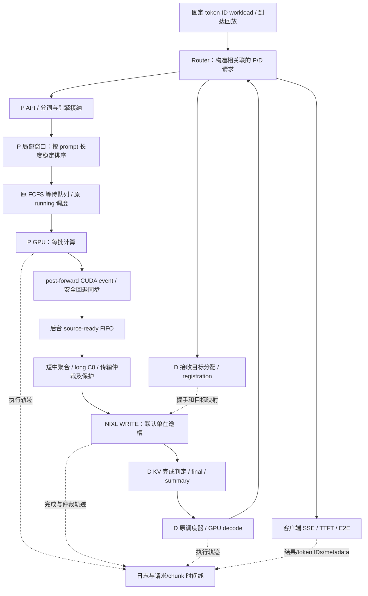

# P/D 分离中局部短任务排序与可抢占 KV 流式传输：全过程技术总结

整理日期：2026-11-11。实现与实验依据截至 2026-11-09 的已归档版本；本次只核对资料、源码和数据，不新增性能实验。本文是写论文前的技术材料总结，不是论文正文，也不替代原始实验记录。

工作目录：`/home/ubuntu/zjj/code`。主实现环境：`/home/ubuntu/miniconda3/envs/cc`。

本文统一使用用户最终确认的命名：**新完整方案包含 P 侧局部排序；旧方案是没有局部排序的原完整传输方案；baseline 是项目中整请求 KV 传输的对照路径。**历史报告里的 full/完整方案，大多指今天所称的旧方案，引用时必须重新标注，不能混用。

## 阅读索引

1. [最终完成了什么、没有证明什么](#1-最终完成了什么没有证明什么)
2. [术语、研究问题与技术层次](#2-术语研究问题与技术层次)
3. [完整架构和端到端请求流程](#3-完整架构和端到端请求流程)
4. [P 侧局部排序的精确定义与实现](#4-p-侧局部排序的精确定义与实现)
5. [KV 生成、分块、聚合与提前发送](#5-kv-生成分块聚合与提前发送)
6. [传输仲裁与长请求保护](#6-传输仲裁与长请求保护)
7. [异步重叠、CUDA 可见性和后台推进](#7-异步重叠cuda-可见性和后台推进)
8. [完成协议、资源生命周期、取消和失败](#8-完成协议资源生命周期取消和失败)
9. [从最初原型到最终版本的演进](#9-从最初原型到最终版本的演进)
10. [主要困难及其诊断与修复](#10-主要困难及其诊断与修复)
11. [实验平台、固定负载和发送过程](#11-实验平台固定负载和发送过程)
12. [测量体系和正确性标准](#12-测量体系和正确性标准)
13. [按阶段整理的实验结果](#13-按阶段整理的实验结果)
14. [最终三方案对比的详细数据](#14-最终三方案对比的详细数据)
15. [为什么有效、代价在哪里](#15-为什么有效代价在哪里)
16. [与官方框架及传输技术的关系](#16-与官方框架及传输技术的关系)
17. [代码、参数、复现和证据索引](#17-代码参数复现和证据索引)
18. [已完成验证、局限和后续研究材料](#18-已完成验证局限和后续研究材料)
19. [未来写论文时可使用与应避免的表述](#19-未来写论文时可使用与应避免的表述)

## 1. 最终完成了什么、没有证明什么

### 1.1 最终设计

这是一个基于 vLLM、NIXL 和 UCX 的单机双 GPU P/D 分离原型。P 在一张 GPU 上计算 prompt，D 在另一张 GPU 上接收 KV 后生成输出。它把优化串在两处排队点上：

- **P 的接纳队列**：把短时间窗口内接纳的请求按 prompt token 数升序排列，让短中请求更早获得计算预算。
- **P→D 的传输队列**：每个计算 batch 完成后尽早提交已就绪 KV，短中请求按请求、按本批聚合，长请求以 C8 分块；在 chunk 边界允许短请求越过未受保护的长请求。

D 不新增长度优先级。D 只有在该请求所需 KV 全部到齐且满足可见性条件之后，才通过既有调度器继续 decode。KV 完成顺序影响 D 的可运行资格，但不承诺严格单请求串行、逐条完成或最终输出顺序完全相同。

### 1.2 最终实现和默认值

| 组成 | 最终实现 | 关键边界 |
| --- | --- | --- |
| P 局部排序 | 固定 20ms 接纳窗口，按真实 prompt token 数稳定升序 | 只改新请求入等待队列的顺序，不抢占运行中的 GPU 计算 |
| 排序开关 | `PD_LOCAL_SORT=1/0` | 新完整方案实验开启；launcher 默认仍为 0，保留兼容入口 |
| 窗口间顺序 | 先前窗口在前，后续窗口追加到原 FCFS 队列 | 不是全局最短任务优先，后窗短请求不越过前窗等待请求 |
| 提前发送 | 每批计算完成后后台发送已就绪 KV | 提前进入传输队列不代表已经传完，也不代表释放源显存 |
| 短中聚合 | 同一请求在同一 batch 新就绪的完整 KV blocks 聚合 | 不把多个请求打包为一个 WRITE；跨 batch 仍可多次发送 |
| 长请求分块 | 8 blocks，每 block 对应 16 tokens，即通常 128 tokens/chunk | 末尾不足 8 blocks 可以单独传；计算 batch 预算是另一参数 |
| 传输抢占 | 当前 chunk 安全完成后重新仲裁 | 不取消、切开已经提交的 WRITE/DMA |
| long 保护 | 成功进度≥85%，或被越过次数≥3，或插队累计等待≥50ms | 三项 OR；阈值按 chunk 边界检查，不是总延迟 SLA |
| CUDA fence | 已审计路径用 post-forward event，后台 query | 不支持的路径安全回退全设备同步 |
| WRITE 并发 | 默认单槽；握手/延迟启动也占槽 | 2/4 槽仅保留探索实现，不作为最终收益来源 |
| UCX TCP | baseline/旧/新均 TX/RX=128KB | 公共传输层优化，不能全记为新调度算法的贡献 |
| D 调度 | 保持原调度器，KV 完成后获得运行资格 | 无新增 shortest-first/priority 策略 |

### 1.3 目前最直接的结论

同一 15 请求、三批到达的最终实验中，新完整方案相对 baseline：250ms/500ms 两场景总时间分别减少 8.89%/10.02%，short 平均 TTFT 分别减少 34.83%/35.81%。相对旧方案，新增排序带来更明显的 short/medium 延迟收益，总时间只进一步减少约 2%。

与此同时，新方案 long 类平均 TTFT 相比旧方案增加约 3.71%/4.32%。**类别平均值不能替代逐条保证**：例如 250ms 下 07-long 的新方案平均 TTFT 还高于 baseline。所有 long 都更快、所有请求都改善，不是最终数据支持的结论。

这是一套在固定模型、小规模合成负载和 TCP loopback 环境中完成实现、调试、对照和重复验证的方案。尚未证明生产规模、跨机器 RDMA、不同模型、长输出 decode 或任意到达过程下都有相同优势。

## 2. 术语、研究问题与技术层次

### 2.1 为什么 P/D 分离需要关注 KV 搬运

P 计算 prompt 的 attention KV；D 后续生成必须读取这些 KV。分离后，P 的计算完成、KV 在 P 上可读、KV 传输提交、KV 在 D 上可用、D 获得计算预算，是不同时间点。

长输入产生的 KV 多。如果请求级传输或计算排队让长请求占据关键位置，短请求即便计算量和 KV 都很小，也可能长时间等待。只优化传输带宽不能消除 P 的计算排队；只优化计算接纳，也不能消除传输队列中的长请求占用。

本设计的出发点是协调这两处排队：让短中请求更早产生可传 KV，再让这些 KV 在允许的边界优先送达 D，并约束长请求受到的额外延后。

### 2.2 必须分开的六个概念

| 概念 | 回答的问题 | 当前实现 |
| --- | --- | --- |
| chunked prefill | 一次调度给多少 prompt tokens 做计算？ | vLLM 预算 2048 tokens，可包含多请求 |
| KV 分块 | 一个传输任务包含多少 KV blocks？ | long C8；短中按本计算批聚合 |
| 提前/流式发送 KV | 何时允许发送？ | prompt 全部完成前，按 batch 就绪部分提前提交 |
| 异步传输 | 计算线程是否等待传输全部完成？ | 独立 writer、event 就绪队列和 completion 处理 |
| 计算传输重叠 | 实际执行区间是否交叠？ | 有设备 trace 证据，但覆盖范围主要为 P DtoH staging |
| SSE 流式输出 | 用户何时收到生成 token？ | Router/客户端 SSE；与 KV 流式发送不是同一种“流式” |

分块不自动包含提前发送；提前发送不自动保证物理重叠；异步 API 不保证调用开销接近零；存在重叠也不保证总时间降低。整个调试过程反复证明这些区别必要。

### 2.3 batch、窗口、客户端批次不能混用

- **计算 batch**：vLLM 某次 GPU 执行所调度的请求/token 集合，动态变化。
- **局部排序窗口**：P 调度器接纳时刻划定的 20ms 时间区间。
- **客户端发送批次**：实验中原 15 条按位置分成的 3×5 条，批起点相隔 250/500ms。
- **传输 chunk**：writer 选择和提交的 KV 数据单元。

一个客户端批次可能在 P 形成两个排序窗口；一个请求可能跨多个计算 batch；一个计算 batch 可以生成很多 long chunk；这些数量并不一一对应。

### 2.4 目标的演进

最初主要解决传输中 short 被 long 阻挡，并加入三项防饥饿规则。随后发现单纯分块的端到端开销很高，工作重心转为：先保证正确性，再验证真实重叠，定位 UCX staging 和 writer 提交瓶颈，最后通过局部排序提前供给短中请求的 KV。

最终目标包含：short/medium TTFT、整批 makespan、long 的平均与逐请求代价、输出一致性和资源安全。旧阶段曾用“每条 long E2E 不超过配对 baseline +10%”作为候选分析约束；它不是系统保证，也没有被实现为硬实时 SLA。

## 3. 完整架构和端到端请求流程

### 3.1 架构



### 3.2 单个请求的正常路径

1. 客户端按时间表提交 JSON：request_id、token-ID prompt、max_tokens、seed、temperature 等。
2. Router 构造 P、D 两条相互关联的请求。P 使用 `do_remote_decode`，D 使用 `do_remote_prefill`，携带远端 engine、request、host、port 及并行维度信息。P 的一次性输出不作为用户结果；P max_tokens=1，D 按实验生成 8 tokens。
3. Router 尽早提交 D，让它分配接收 KV 的目标 blocks 并通知 P；P 与 D 请求可以并发准备，不要求等 P 完成才登记 D。
4. P 接纳已分词请求。排序关闭直接走原队列；排序开启先进入局部窗口，窗口到期按长度排序后追加到等待队列。
5. P 原调度器继续工作，每轮最多分配配置的计算 token 预算。running 请求沿原行为处理，窗口排序不打断其 GPU kernel。
6. P connector scheduler 按本轮将完成的 prompt frontier 准备新 KV chunk metadata。真正允许后台使用这些源数据，要经过 post-forward fence。
7. event 未就绪时批次留在 source-ready FIFO；writer 同时继续处理已启动传输、握手、注册、取消和完成事件。
8. event 就绪后，chunk 才进入传输仲裁。若 D 注册尚未到齐，P 等待匹配；握手和 deferred 启动不能绕过在途容量限制。
9. writer 选择 chunk，建立块映射、描述符和 NIXL 请求，提交 WRITE。long 分块，短中按本批聚合。当前 WRITE 不在中途抢占。
10. WRITE 成功确认后更新 long 的成功进度，再选择下一任务。P 对 D 发送 chunk 序号/终止信息；全部相关任务成功后才允许请求级 summary。
11. D 确认所需 KV 完成，沿既有 scheduler 获得非空计算调度，EngineCore 提交模型执行，产生输出。
12. Router 将 D 响应以 SSE 返回客户端。采集首个非空文本事件和完整响应结束时刻。
13. P 源 blocks、send lease、writer 状态等在安全完成边界回收；完成与失败处理保持幂等，不靠 TTL 作为正常结束机制。

### 3.3 控制信息与数据的区别

请求关联、registration、握手、chunk 通知、summary、取消和失败，是控制面；真正的 KV buffer WRITE 是数据面。控制面发出 final 或 summary 之前，必须有足够的数据面完成证据。早期最严重的一次错误，恰恰来自控制面宣告完成早于数据面 WRITE 完成。

## 4. P 侧局部排序的精确定义与实现

### 4.1 为什么后加排序

旧方案只在 KV 就绪后提供传输优先机会。如果短请求排在 long 后面，P 没给它计算预算，它就没有 KV 可加入传输队列，再强的传输优先级也无从发挥。

全局按长度重排会让时间相隔较远的请求彼此竞争，也可能加剧 long 的等待。用户要求的是“几乎同时到达的局部排序，间隔远的保持时间顺序”，因此最终采用时间窗口而不是全局 SJF。

### 4.2 窗口和排序规则

设窗口长度 `Δ=20ms`。P 接纳首个新请求的单调时刻为 `a`，窗口范围 `[a,a+Δ)`。新请求在当前窗口 deadline 之前接纳，就加入该窗口；达到或超过 deadline，则创建以该请求接纳时刻为起点的新窗口。

窗口不因新到达而延长。到期后，在下一次 `schedule()` 调用中，按 `(num_prompt_tokens, 实际接纳时刻)` 排序并追加到原等待队列。这里 num_prompt_tokens 是框架实际 prompt 长度，不信任客户端的 category 或声明长度。

相同长度保持实际接纳顺序，不保证与 JSONL 的序号一致。不同窗口按窗口创建顺序释放；如果一次调度时多个窗口都已过期，也分别排序、按窗追加，不能合并再做全局排序。

### 4.3 为什么不是客户端排序

最初的过渡实现把每五条在客户端排好再并发 HTTP 提交，还把分批到达和排序开关绑定。它有两个问题：

1. 客户端 submit 顺序不是 Router 到达顺序，更不是 P 接纳顺序；线程池、TCP、API 处理和引擎队列都可能改变次序。
2. 开启排序同时改变到达模式，开关对照无法只归因于排序。

最终改为：客户端保留原始顺序，`--grouped-arrivals` 独立决定发送节奏；`--local-sort` 对应服务端 P 排序。只在 Router 并发转发前排序同样不能保证 P 队列顺序，因此排序实现在调度器中。也不能等待前一个 P HTTP 请求完全返回才发下一个，那会把请求串行化并破坏重叠。

### 4.4 代码挂接方式

`pd_local_sort_scheduler.py` 提供 `LocalWindowBuffer`、`LocalSortMixin`、`LocalSortAsyncScheduler` 和同步配置用的 `LocalSortScheduler`。launcher 在开启时只给 P 传 `--scheduler-cls pd_local_sort_scheduler.LocalSortAsyncScheduler`，通过 PYTHONPATH 使引擎进程能导入模块；D 不加载该类。

选择继承 AsyncScheduler 是为了保留原框架的异步调度路径，避免“新增排序”的同时意外关闭异步调度。当前 launcher 使用异步版本；同步类是保留入口，不能据此声称两种调度模式都完成相同性能验收。

Mixin 仍调用 vLLM 原 `add_request()` 完成请求登记、connector 新请求通知及事件记录，只拦截新请求首次加入 waiting queue 的动作。这样取消逻辑仍能在 `self.requests` 找到请求，而不是让待排序请求消失在框架视野之外。

### 4.5 容易遗漏的实现细节

- 待排序请求计入 `get_request_counts()`，即使当前只有一个尚未到期的窗口，也让引擎继续轮询；否则引擎可能休眠，窗口永远得不到释放。
- `finish_requests()` 调用原有清理后，从窗口缓冲中删除已结束/取消请求，防止稍后误入队。迭代器参数先保存，避免上游消费后无法再次处理。
- 局部排序要求 FCFS 策略；若混用另一套全局 priority queue，窗口间顺序可能不再满足设计，所以当前直接拒绝这种配置。
- 不等满五条。孤立请求、缺失请求、最后不足五条均按时间释放，不会无限等待凑组。
- 新增日志 `PD local admission`，记录 window、rank、request_id、真实 tokens、arrived/deadline/released 时刻和 wait_ms。
- CSV 的 `dispatch_group/rank` 仅表示客户端发送分组及原始位置；不能当成实际 P 排序结果。
- `PD_LOCAL_SORT` 改变需要重启服务，不是在线热切换。

### 4.6 固定窗口不等于等待上限

20ms 是收集区间，不是承诺 20ms 后引擎一定立即执行释放。P 正在处理模型结果或等待 GPU 时，只能在下一次 schedule 调用释放。最终三方案实验中，实际接纳到释放等待最大约 232.84ms，已计入客户端 TTFT。

实验中 15 条计划分三批发送，但新方案六次正式轮只有四次在 P 形成 `[5,5,5]`；另外两次首批被分成 `[3,2]` 或 `[2,3]`。这不是排序漏请求，而是 HTTP/引擎接纳抖动导致请求跨过 20ms deadline。报告保留这两次，不为形成漂亮的“三组五条”扩大窗口或选择性重跑。

### 4.7 排序与跨批抢占的关系

后批短请求不会通过 P 的局部排序越过前窗等待的 long，也不会打断已运行 long 的计算。只有后批短请求真正获得计算、KV 就绪并进入传输队列，才可能在数据面越过未受保护 long。这个边界解释了为什么第三批 short 仍可能等待很久，也解释了“客户端已经到达”不等于“马上能抢占传输”。

## 5. KV 生成、分块、聚合与提前发送

### 5.1 请求级状态

P scheduler 保存请求最终 prompt KV block 总数、下一待发送 block cursor、下一个 chunk sequence、类别、final 是否已入队，以及请求关联。最终总量必须跨计算 batch 稳定；不能把本轮只分配/计算到的 block 数当成整个请求大小，否则偏移和保护进度都会错。

对一个 prompt 长度 `L`、block_size `B=16` 的请求，总 blocks `N=ceil(L/B)`。本轮预计计算到的 token frontier 为：

```text
computed_end = min(num_computed_tokens + num_scheduled_tokens, L)
若 prompt 尚未完成：ready_blocks = floor(computed_end / B)
若 prompt 已全部完成：ready_blocks = ceil(L / B)
ready_blocks 还必须受实际分配 blocks 和请求总量约束。
```

中间 batch 只释放完整 blocks，不能将仍会写入的部分 block 提前暴露。最终 prompt 完成后允许发送末尾不完整 token block 的有效内容及终止信息。

### 5.2 长请求 C8

从 cursor 向 ready frontier 切出最多 8 blocks 的 chunk。非最终阶段若新就绪数据不足 8 blocks，可留到后续凑够；最终阶段尾块不足 8 也必须发送。sequence 逐个增加，同一请求覆盖区间不能缺失、重叠或越界。

10000-token long 有 625 blocks，因此通常为 78 个 8-block chunk 加 1 个 1-block 尾 chunk，共 79 个；四条 long 共 316 个。这个数是当前固定负载几何，不是所有请求的常量。

### 5.3 短中请求的 batch 聚合

同一个请求在当前 batch 新就绪的 blocks 合成一个传输单元，不再统一按 C8 切碎。但如果该请求跨多个计算 batch，仍有多个传输单元；不能为了等整个 medium 计算完才聚合，反而丢掉提前发送机会。

“整体传输”的准确含义是**该请求本 batch 的新 KV 整体**，不是把 batch 中所有 short/medium 合并成一个大包，也不是所有 medium 永远只传一次。跨请求打包需要额外的打包 buffer、请求映射和生命周期设计，本项目没有实现。

一个 short 128 tokens 本来正好 8 blocks，C8 已能一次发送；若它在计算 batch 边界被拆成 2+6 blocks，batch 聚合会提前形成两个传输单元。所以聚合并不保证每条 short 的 chunk 数更少。

### 5.4 final、空块和 prefix cache

最后一个覆盖到请求末尾的 chunk 带 final。若数据 cursor 已完成但仍需给出终止信息，也允许空 final marker。D 已命中 prefix blocks 的部分可以无需 WRITE，但仍必须有可解释的序号/终止完成路径，不能因“没数据可搬”而让 D 永久等待序列。

主要性能实验显式关闭 prefix cache；prefix-cache 专项验证只用来检查映射和进度分母，不与关闭缓存的性能数据混作一组。

### 5.5 提前发送的开关

`stream_by_batch=true` 时，新就绪 chunk 不等整条 prompt 完成就下发。`false` 的 no_stream 消融保留同样的每批 chunk 边界，只将它们按请求暂存，直到 prompt-final 才统一释放。这样比较尽量隔离“释放时机”，而不是同时把分块和调度协议全部删除。

### 5.6 量级估算：为什么长输入的数据搬运不可忽略

本地模型配置为 32 层、8 KV heads、head_dim=128、BF16。只按 K/V 主体计算，单 token KV 理论约为 `2×32×8×128×2=131072 bytes=128KiB`；16-token block 约 2MiB，C8 约 16MiB，10000-token prompt 约 1.221GiB。

这只是由模型配置推得的 payload 量级，不包含布局 padding、协议、描述符或实际 prefix 命中，也不是 profiler 测得字节数。它说明：128-token 传输 chunk 在 token 数上不大，在这个模型的跨层 KV 上却约为十几 MiB；仍可能在 TCP staging 内分成很多更小操作。

## 6. 传输仲裁与长请求保护

### 6.1 分类

`prompt_tokens<256` 为 short，`prompt_tokens>8192` 为 long，其他为 medium。边界 256、8192 都属于 medium。分类按原始 prompt 长度，不随已计算/已传输进度改变。

P 窗口排序按所有请求的精确长度；传输仲裁使用这三个类别。两处策略不是同一个排序规则。

### 6.2 仲裁的具体行为

基础队列是 FIFO。队首不是 long，就按原顺序处理。队首为 long 时，更新插队等待，检查是否保护；若未保护且队列前部可找到 short，则允许该 short 越过 long。扫描遇到 medium 即形成屏障，short 不跨过 medium。

因此它不是任意 global shortest-transfer-first，也不允许 medium 主动抢占 long。当前 medium 屏障是保留并验证的规则，可能限制某些 short 的机会；尚无专项实验确定它是最佳选择。

### 6.3 三项保护的数学定义

对 long 请求 `r` 定义：

```text
N_r：该请求实际需要传输的 blocks 总量（排除 D prefix 命中）
C_r：已确认成功传输的有效 blocks 数
p_r = C_r / max(1, N_r)
k_r：short chunk 实际越过该 long 的次数
w_r：因 short 插队而累计等待的毫秒数

protected(r) = (p_r ≥ 0.85) OR (k_r ≥ 3) OR (w_r ≥ 50ms)
```

实现保护状态具有保持性；达到条件后不会因为后续队列变化又解除。成功进度应先于下一次仲裁更新，不能让已经达到 85% 的 long 因 completion inbox 延迟处理又被插队。

### 6.4 次数、进度、等待分别怎样记

- 次数按**一次 short chunk 越过 long**记一次，不是按 short HTTP 请求唯一计数。一个 short 若跨两个 batch 产生两个 chunk，可能造成两次计数。
- 进度按已成功传输的数据记，不按入队、提交或预计完成记；失败和 prefix 命中不增加成功量。
- 等待从第一次被插队开始，直到 long 恢复被选中；连续多个 short 的区间累加；多次被插队的区间也累加。正常计算、registration 等待和 long 自身传输不属于这项等待。
- float 精确边界使用极小容差 `1e-9ms`，确保逻辑测试中的 50.000ms 不因浮点误差继续放行。

### 6.5 保护不提供哪些保证

50ms 不是 long 的总排队上限、TTFT 上限或 E2E 上限，也不能在 50.000ms 时切断正在传输的 short chunk。次数上限按每条 long 分别应用，全 workload 抢占总数可以超过 3。三项保护只约束后续插队机会，不能抵消分块、协议、计算排队或底层 staging 的全部开销。

### 6.6 专项验证与主实验不同

专项 GPU 控制中把另外两项阈值调宽，以单独观察等待保护：第八次 short 插队时累计 49.907ms，下一边界在 56.690ms 以 wait 原因恢复。prefix 命中专项中实际分母为 179 blocks，152/179=84.916% 后仍未到阈值，156/179=87.15% 后保护。精确 85% 和 50.000ms 边界另由可控时钟逻辑测试覆盖。

这些证明规则确实接入，而不是证明当前每个性能实验都触发三项规则。后期 27 点扫描中等待保护一次也未触发，这是另一项重要结论。

## 7. 异步重叠、CUDA 可见性和后台推进

### 7.1 为什么不能直接后台读 KV

scheduler 在 GPU 执行前准备 metadata，不代表源 KV 已写好。即使 Python 的 forward 调用返回，也不必然表示所有 CUDA kernel 完成。后台 writer 若立即 READ/WRITE 同一源 block，可能读取旧数据或正在修改的内容。

因此“异步”不能靠删掉同步实现，必须建立 producer 计算到数据搬运的可证明依赖。

### 7.2 同步方案的演进

1. 早期同步当前 CUDA stream，尝试保证本批结果可读。
2. 遇到跨 stream 可见性风险后，使用全设备 `torch.cuda.synchronize()` 作为保守正确性边界，记录 host 阻塞耗时。
3. 尝试把全设备同步移到 writer，但 writer 被阻塞时无法及时推进已有传输、注册和完成，实验更慢，未采用。
4. 最终在经过审计的实际 V2 runner 路径建立 post-forward CUDA event，后台只做非阻塞 query，未支持路径仍全设备同步回退。

不能把第二步的同步耗时全当成“新增开销”：它包含本来就必须完成的 GPU 工作。减少同步调用阻塞不等于端到端一定减少同样的毫秒数。

### 7.3 event 实现的范围

当前主要在 `vllm/v1/worker/gpu/kv_connector.py` 的 post-forward 路径记录 producer 当前 stream event。事件保存在 worker 本地 metadata，不把 CUDA 对象跨进程传给 scheduler。

启用检查包括 LlamaForCausalLM，TP/PP/DCP/PCP=1，无 DBO/ubatching、无 speculative decode、无权重 offload，且本批不是 sync KV load。这里审计的是当前模型和 runner 的 KV 写入 stream 关系，不是任何模型、任何多 stream 执行图都能套用的通用保证。

### 7.4 writer 的 event 队列

writer 保留批次与 event，执行 `event.query()`。未就绪时不把该批 chunk 暴露给仲裁器，同时继续处理其他控制与已在途任务。source batches 保持 FIFO：前面的 event 未就绪，不允许后面 final 所在批次越过。

event query 失败走正常失败清理。取消时 source-pending 计数阻止尚在等待 fence 的源 blocks 被提早回收；不能只看当前 active WRITE 数为零就释放整条请求。

### 7.5 真实重叠的证据与限制

旧 C4 profile 中 P 计算 busy 约 4779.842ms，P DtoH busy 257.656ms，区间交集 193.079ms，即 DtoH busy 的 74.94%。设备时间戳来自 CUPTI，而不是用 host enqueue 假装 DMA。

但该 profile 只看见 P 端 Device→Pageable Host staging，不包含 CPU/socket、D HtoD 和窗口外尾部。只隐藏这几百毫秒，不能自动抵消数秒的 writer 提交工作。

后续 128KB/C8 profile 的 P 计算 busy 约 4782.561ms，DtoH busy 314.167ms，其中 313.508ms 与计算交叠，约 99.79%。两个 profile 的应用 chunk 不同，不能单凭它们隔离 C4→C8 的贡献；真正隔离 UCX 分段的是同版 C8 的 8KB/128KB 控制实验。

### 7.6 完整方案没有实现传到一半就 decode

传输与 P 后续计算可以重叠；D 仍需等该请求所需 KV 完整，再进行该请求的 decode。不是只收到一部分上下文 KV 就使用不完整 attention，也没有改变模型的语义依赖。

## 8. 完成协议、资源生命周期、取消和失败

### 8.1 正常完成的两层证据

D 跟踪 chunk sequence、接收情况和 final；只有满足完整接收条件才能完成。P 另外在全部 chunk 的 WRITE/notification 成功后发送请求级 `VLLM_KV_STREAM_DONE` 汇总，以覆盖高 chunk 数时逐 chunk 通知不足导致的永久等待。

summary 是 P 对“全部已成功”的证明，不是 final chunk 一完成就能发的捷径。它必须保留真实 final sequence，并等待前序 deferred/queued/in-flight chunk 全部结束。否则 summary 会把数据缺失伪装为成功。

### 8.2 单 WRITE 槽包含握手阶段

最初只在真正启动 WRITE 后才设 active。握手期间先选出的 chunk 未占槽，后续 chunk 可能越过并先完成，破坏原有顺序。最终把从握手到 deferred WRITE 启动/失败的区间也算作已占用的传输机会。

deferred inbox 可以包含多个回调结果，但只能在安全空槽时启动；不能连续启动覆盖前一个活动句柄。多槽探索版本用 request/sequence 索引所有句柄，取消时也要保护全部 DMA 源块；最终默认仍 1。

### 8.3 send lease 和块持有

P prompt 计算结束不是 KV 传输结束。P 必须保留源 blocks 到实际 DMA 安全完成；D 的 receive 完成也不能误报成 P send 完成。

还存在“后台已完成，但 scheduler 的 send lease metadata 尚未登记”的反向竞态：清理后如果 scheduler 又建 lease，会产生假泄漏/TTL 到期。因此终态、lease 登记、source fence、in-flight DMA 和 completion 上报必须协调，且只清理/上报一次。

正常成功应立即沿安全路径回收；TTL 是异常兜底，不应靠等 TTL 才把每个成功请求清掉。

### 8.4 取消与失败传播

- Router 一侧连接失败、超时或错误时，显式调用另一侧 vLLM abort API；仅 `Future.cancel()` 取消不了已经发送的上游请求。
- D 的主动 abort 沿控制面通知 P 取消相应发送；框架内部 ID 会带后缀，匹配需要遵守实际关联规则。
- arbiter 待发队列和迟到的 chunks 必须识别取消状态，不允许请求终止后重新排队。
- WRITE 失败不能增加进度、不能发送成功 summary；已在途 DMA 仍等安全完成，避免使用已释放源内存。
- registration watchdog 超时通过 metadata 下发 `push_failed_receives`，worker 转成接收失败并经原完成路径报告，不能只在 scheduler 内标记而让 D worker 无限等。
- 重复 chunk/summary/完成事件保持幂等，不重复释放或复活请求。

### 8.5 已有真实故障恢复证据

| 故障/边界 | 观测结果 | 证据 |
| --- | --- | --- |
| registration 超时 | 0.5s watchdog 后 long 错误结束，同组后续 short 成功 | `logs/d-registration-timeout-20261105/` |
| WRITE seq=0 注入失败 | long 返回 500；后续 short 200；TTL 后 expired reqs=0 | `logs/d-write-failure-verified-20261105/` |
| D 主动取消 | abort 200，迟到 376 chunks 丢弃/失败完成，后续 short 正常 | `logs/d-active-cancel-verified-20261105/` |
| P worker 退出 | Router 502，D abort 200，重启后 short 成功 | `logs/d-worker-exit-fixed-20261105/` |
| 同一服务连续两批 | 两批 short/medium/long 全成功，序号完整 | `logs/b1-deferred-repeat-20261105/` |

这些注入来自对应历史阶段，不能冒充“最终排序版本对所有故障又完整做了一遍 GPU 注入”。最新排序取消由回归覆盖；event pending 取消边界也有逻辑测试，但并非每个组合都有独立最终 GPU 故障实验。

## 9. 从最初原型到最终版本的演进

| 阶段 | 想解决的问题 | 实施与发现 | 状态/解读 |
| --- | --- | --- | --- |
| 2026-11-03 初始链路 | 两卡 P/D 能启动并搬运 KV | 修工具链、NIXL agent、握手与请求配对；整请求 baseline 成功 | 抢占原型 mixed long 仍超时，不能称为可用完整系统 |
| 11-05 传输生命周期 | 部分 WRITE 成功但 D 不结束 | 稳定请求总量、空块通知、summary、send/receive 完成方向、deferred 单槽、lease 清理 | 三请求、重复批次和故障恢复逐步通过 |
| 11-05/06 测量补齐 | 只有 HTTP 延迟，不知道卡在哪里 | SSE TTFT、P/D 事件、chunk 时间线、D 首调度/首提交、执行累计、环境归档 | 可区分排队、执行和传输，而非只看成功率 |
| 11-06 数值一致性调查 | 同样输入输出不同 | 无传输 solo/mixed、logprobs 控制；默认开启 batch invariant | 修复批形状数值混杂，仍不能解释后续所有差异 |
| 11-06 早期 C4 参数搜索 | 改善短请求并约束 long | 27 点搜索及三轮候选确认 | 混有 long 错误；保留失败，不宣布稳健最优 |
| 11-06 long 输出竞态修复 | batch invariant 后仍输出错误 | 握手占槽、全部完成才 summary、保守设备 fence | 完整修复 180/180 正确，但总时间仍较 baseline 慢 |
| 11-06 重叠验证 | 是否真正计算/传输并行 | writer 同步尝试更慢；event FIFO＋设备 profile 确认交叠 | 存在重叠，却仍有约 19% 总时间劣势 |
| 11-06 短中聚合＋C8 | 减少不必要细小应用传输 | chunk 大幅减少，固定 85/3/50 三轮 | 仍慢约 24.6%；应用 chunk 不是全部瓶颈 |
| 11-06 UCX 根因诊断 | 为什么重叠且少 chunk 仍慢 | NIXL transfer host 计时、8KB staging profile、同版128KB控制 | 双方统一128KB后，候选开始重复取得整体优势 |
| 11-06 后台调度修正 | 更新进度滞后、提交间隙 | 先 poll/update 再仲裁，event 默认统一；eager progress 未采纳 | 三轮优势确认，不能把每次小改都称为再加速 |
| 11-06 三模块消融 | 谁贡献了收益 | no_stream / no_aggregation / FIFO 与 full 同版比较 | 提前发送主导，聚合边际很小，抢占有条件收益 |
| 11-06 新27点扫描 | 固定3次，找进度/等待组合 | 50～90%×50/100/150ms，插入4 baseline | 观测最小65/3/100，无抢占；未认定全局最优 |
| 11-09 外部框架核查 | 官方是否支持提前发送 | vLLM指定源码审计；SGLang NIXL chunk实跑与checksum smoke | 明确不是“所有框架只能整请求传输” |
| 11-09 局部排序 | 短请求 KV 产生太晚 | 撤掉客户端排序，P AsyncScheduler窗口排序，独立到达开关 | 双卡90请求验收，真实跨批传输抢占 |
| 11-09 最终两场景对照 | 比较baseline、旧、新 | 250/500ms，三方案三轮，轮换顺序 | 18正式轮/270请求，含预热540请求全正确 |

以上日期是现有证据记录的阶段归属，不能据此声称所有报告都对应同一份最终源码。历史计划书采用不断追加的形式，存在旧默认值和旧待办，阅读时应按阶段解读。

## 10. 主要困难及其诊断与修复

### 10.1 环境和启动问题

FlashInfer 初始调用到 CUDA 11.8 nvcc，不识别新编译选项 `--compress-mode=size`；切换到环境内 cu13 编译器。wheel 的库布局还补过 `lib64→lib` 和 CUDA stub 链接。当前 runtime/headers 13.0 与 nvcc 13.4 存在 minor 版本差异，launcher 使用 `CCCL_DISABLE_CTK_COMPATIBILITY_CHECK` 兼容参数，并记录实际环境。

这使当前已测 kernel 路径成功运行，不等于软件依赖全部严格匹配。后期 SGLang 独立 venv 同样存在 `pip check` 不通过的问题，详见第16节。环境状态必须与结果一起公开，不能仅说“官方标准环境”。

### 10.2 long 超时：成功 WRITE 不等于完整接收

初始 mixed 测试 short/medium 成功，long D 等 KV 到超时；P 有 137 次成功 WRITE、零 transfer failure，之后 send lease 到期。诊断不能停在“网络传输了所以完成”，必须核对每个 sequence、final、D 实际接收和资源状态。

修复请求级总量、无 WRITE chunk 的通知和 summary 后，仍发现 medium 尾 chunk 丢失，进一步定位 deferred WRITE 活动句柄覆盖。完整修复后检查 P 17/17 medium、173/173 long 完成，D final_seq 匹配，并在同一服务连续两批复验。

### 10.3 不能删除断言掩盖 completion 方向错误

早期 completion 集合存在 tuple/set 合并错误，以及 D receive 被报进 send completion 的问题，会让 scheduler 错误释放 D blocks。处理应修正类型与方向，而不是删断言或用“活动请求 ID 过滤”丢掉正常完成事件。一个中间过滤尝试会丢正常接收，已撤回。

### 10.4 输出错误第一类：动态 batch 的数值变化

greedy＋相同 seed 只约束采样随机性，不保证不同矩阵形状、attention 分割和 reduction 顺序的浮点结果完全一样。目标 long 的旧默认内核 PD 复跑在第4个生成 token 从 864 变成2532，前三个 token 相同；top logprobs 显示候选并列/排序变化。

无 connector 的 solo/mixed 直接推理也发现 logprobs 差异，表明不能把所有输出差异都归咎于 KV 搬错。开启 `VLLM_BATCH_INVARIANT=1` 后该直接对照的 token 和 top logprobs 一致，后续双方使用相同配置。采集器从只保存文本 hash 改为保存文本、token IDs，并可选 top-5 logprobs。

旧运行只有 hash 的记录无法还原精确分叉 token，不应事后补造。batch-invariant 改了计算路径和性能，跨版本时延不能全部归因于传输。

### 10.5 输出错误第二类：握手越序与提前 summary

在 batch-invariant 已开启后，01-long 仍可出现错误。旧失败轨迹中 seq0～24 在握手时未占单槽，seq25～156 先完成。D 在 monotonic 20375.180449 被提前 summary 判作收齐，但前25块实际 WRITE 到20388.002192才开始、20388.542013才全完成。

这是明确的数据完整性竞态，不能用数值不确定性解释。修复握手占槽、前序全部成功才 summary、真实 final sequence，以及保守可见性 fence；完整修复版本12组180请求与直接参考一致。设备全同步是保护措施，日志直接证实的根因是握手/summary 越序，不能把所有修复项都描述为单独验证的根因。

### 10.6 已经重叠但没变快

event 实验确认 P kernel 与 DtoH 交叠，但 C4 阶段候选总时间仍比 baseline 慢19.14%。旧 profile P计算 busy约4.78s、DtoH busy约0.258s；隐藏0.193s并不足以消除数秒控制/提交和传输尾部。此时正确的下一步是分层计时，而不是继续断言“缺乏重叠”。

### 10.7 应用 chunk 已减少，底层仍在细碎 staging

短中聚合＋C8 把原约698个应用chunk降到约329/330个，仍未获整体优势。profile 显示174720次DtoH中169216次仅8172 bytes。UCX TCP+cuda_copy 经 `rma_am(tcp/lo)` 将每个大应用传输再拆成很多 staging 操作。

新增 WRITE 分阶段计时表明：描述符构造约0.07ms、NIXL请求创建约0.02ms，主要耗时在 native `transfer()` host 调用内。即使 API 支持异步，也可能在此后端花大量 CPU 时间提交/推进 staging。

同版 C8/event/单槽回切控制：8KB long `transfer()` 平均41.933ms、累计13.251s；128KB后平均10.348ms、累计约3.3s。候选makespan从单次16.256s对照降到三轮5.601s左右。双方统一128KB后再比较，才有公平的算法结果。

128KB是传输缓冲/协议分段参数，不是网卡MTU，不是一个TCP包，更不是C8。当前TCP路径仍有staging和协议成本；只调分段不是唯一理论办法，IPC/P2P/RDMA、打包和描述符合并都可能改变路径，但本项目没有验证其收益。

### 10.8 更多并发和更紧轮询不是必然加速

2/4 WRITE槽探索没有稳定解决native提交热点，默认不变。eager progress将提交间隙中位数约1.583→0.501ms，但native提交累计约3.587→4.300s，总时间5.627→5.691s；因此不默认启用。没有证据就不能把差额归给特定锁竞争或CPU争用机制。

修复“poll发现成功但下一轮才更新保护状态”是正确性/策略一致性改善，不能用独立实验不同均值宣称它一定进一步加速。

### 10.9 实验污染和工具问题

历史出现 sweep `--help` 意外启动服务、残留服务占端口却满足新组健康检查、重复启动显存不足、运行中改runner导致收尾退出2、profile窗口从warmup开始但未成功导出、补跑样本与baseline非相邻等问题。

对应措施包括：help提前退出；启动前bind检查端口；保存PID、进程组和GPU映射；只清理本组进程；实验源码快照；区分子组成功与最终runner约束失败；无效目录保留但排除；补跑另建目录并标明版本筛选。启动/JIT/固定等待时间与workload makespan分开。

### 10.10 排序功能从“看起来有”到“真正生效”

客户端预排序不能证明引擎次序，排序和分批耦合会破坏A/B解释。最终以P入队日志和GPU执行预算同时验证：首批3条short各128、medium1107，long使用余下557，总计2048 tokens。仅有客户端配置项或HTTP200不足以证明排序已进入真正计算路径。

待窗口请求计数、单个请求到期释放、取消清理、继承AsyncScheduler、D保持原调度器，都是这个功能完整性的一部分。

## 11. 实验平台、固定负载和发送过程

### 11.1 主要平台

| 项目 | 已归档实验配置 |
| --- | --- |
| 机器拓扑 | 单机两张 RTX 4090，P 物理GPU0，D物理GPU1 |
| 并行 | 每个实例TP=1、PP=1；不是整个系统单卡 |
| 模型 | 本地 Llama-3.1-8B-Instruct，BF16，32层，8 KV heads |
| context配置 | 32768 tokens |
| GPU显存比例 | 0.90 |
| 计算budget | vLLM每batch最多2048 tokens；SGLang chunked prefill=2048 |
| 框架 | vLLM0.32.0；外部对照SGLang0.5.21、sglang-router0.3.2 |
| Python/Torch | Python3.11.18；Torch2.13.0（实际版本见各environment.json） |
| 搬运组件 | NIXL/nixl-cu13 1.5.2，UCX，TCP+cuda_copy |
| 网络选择 | UCX_NET_DEVICES=lo；同机loopback，不经过跨主机物理网络 |
| TCP分段 | 最终双方TX/RX=128k；早期8KB阶段另标注 |
| prefix cache | 正式对照显式关闭；专项prefix测试独立归档 |
| 数值设置 | vLLM双方batch invariant开启、temperature=0、固定逐请求seed |
| 输出长度 | 每条8 tokens，便于集中观察prompt/KV路径 |
| 测试工具 | pytest9.2.0，最新版记录93 passed、14 warnings |

单机TCP传输依旧执行P→D数据搬运，能够验证P/D协议、排队与重叠；但不是RDMA集群或GPU直连互联性能的替代。loopback没有真实跨机链路的拥塞、交换机和时钟同步问题，CPU staging/协议成本可能更突出。

### 11.2 固定15请求

文件：[workload.sweep-interleaved-8s3m4l.jsonl](workload.sweep-interleaved-8s3m4l.jsonl)。SHA256：

```text
714990980c49534e539a125612ce1c8d36c68ac75a559e4bce93dabcb7ee9e14
```

| 编号 | 类别 | 输入tokens | seed | 最终发送批次 |
| --- | --- | ---: | ---: | ---: |
| 00 | short | 128 | 1500 | 0 |
| 01 | long | 10000 | 1501 | 0 |
| 02 | short | 128 | 1502 | 0 |
| 03 | medium | 1107 | 1503 | 0 |
| 04 | short | 128 | 1504 | 0 |
| 05 | long | 10000 | 1505 | 1 |
| 06 | short | 128 | 1506 | 1 |
| 07 | long | 10000 | 1507 | 1 |
| 08 | short | 128 | 1508 | 1 |
| 09 | medium | 1107 | 1509 | 1 |
| 10 | short | 128 | 1510 | 2 |
| 11 | long | 10000 | 1511 | 2 |
| 12 | short | 128 | 1512 | 2 |
| 13 | medium | 1107 | 1513 | 2 |
| 14 | short | 128 | 1514 | 2 |

合计44345个输入tokens：8 short、3 medium、4 long。全部是预先确定的token-ID prompts，避免不同输入文本在不同服务中重新分词导致长度变化。项目生成器使用普通词池构造和截断确定长度；这个固定交错文件是独立保存、按hash核对的合成负载。不能把它称为公开真实业务数据集，也不能用生成器当前默认参数替代该固定文件后声称测试集未变。

较短输出使实验更偏重prefill/KV/TTFT，尚不能代表数百或数千输出tokens时的decode负载。逐请求seed是1500～1514；某些历史报告提到全局seed或启动random seed=0，并不代表CSV里逐请求seed也全是0。复现应以原JSONL及metadata为准。

### 11.3 到达过程的演进

早期三请求smoke与10请求7/1/2固定集用于功能验证；后期主要采用上述15请求。早期对比、消融、参数扫描及SGLang对照多数为并发上限15、每100ms发下一条，并非15条同时发出。并发上限只表示最多同时在途多少条，不等于提交时刻。

新增排序后分为三批：原00～04、05～09、10～14；每批原始顺序和内容不变。正式最终只测试：

| 场景 | 第1批 | 第2批 | 第3批 | 批内间隔 |
| --- | ---: | ---: | ---: | ---: |
| 密集 | 0ms | 250ms | 500ms | 0ms |
| 主实验 | 0ms | 500ms | 1000ms | 0ms |

用户明确取消分散场景，所以没有1000ms批间隔正式实验。三批计划起点由绝对时间偏移计算，不等上一批完成，也不在上一批结束后再sleep。并发15避免请求线程被前批占满，导致后批客户端排队。记录submitted_at、真正线程开始、Router接收和P接纳，以识别误差。

### 11.4 三方案严格定义

| 项目 | baseline | 旧方案 | 新完整方案 |
| --- | --- | --- | --- |
| 框架与公共NIXL/UCX | 相同 | 相同 | 相同 |
| master preemptive开关 | false | true | true |
| 等整条prompt完成后整请求发送 | 是，原对照路径 | 否 | 否 |
| batch提前发送 | 无自研流式路径 | 是 | 是 |
| short/medium按batch聚合 | master关闭，不激活自研策略 | 是 | 是 |
| long C8 | 自研chunk路径不激活 | 是 | 是 |
| short传输插队＋三项保护 | 不激活 | 是 | 是 |
| P局部排序 | 关 | 关 | 开 |
| D优先级改动 | 无 | 无 | 无 |
| UCX128k、prefix关闭、计算配置 | 一致 | 一致 | 一致 |

baseline使用项目中相同`NixlPushConnector`的整请求分支，不是用另一套官方pull connector重新搭建的服务。共同路径还包含既有测量和修复，不能把它称为“完全未修改的官方vLLM端到端系统”。官方源码核查支持该push分支在request_finished后导出的时机，但不等于所有官方NIXL变种、所有框架都只整请求发送。

### 11.5 最终重复与顺序

共9次服务启动：每轮三方案，每次服务对两种间隔各预热一次，再各正式一次。每场景每方案有三次正式重复，即2×3×3=18次，正式270请求，预热270请求，共540请求。

| 轮次 | 三方案运行顺序 | 每方案两个场景顺序 |
| --- | --- | --- |
| 1 | baseline→旧→新 | 250→500ms |
| 2 | 旧→新→baseline | 500→250ms |
| 3 | 新→baseline→旧 | 250→500ms |

轮换减轻时间漂移影响，但三轮仍是小样本。不能把270请求当成270个独立的系统重复，也不能用类别少量样本宣称稳定p99。

## 12. 测量体系和正确性标准

### 12.1 时间点与区间

```text
客户端计划/提交
  →线程真正开始发送
  →Router接收
  →P接纳 / 排序窗口 / 等待与计算
  →P各batch源KV就绪
  →chunk进入仲裁 / WRITE提交 / 完成
  →D KV完整
  →D首次非空调度
  →D首次execute_model提交
  →客户端收到首个非空文本
  →完整响应结束
```

| 指标 | 精确定义 | 不能误解成 |
| --- | --- | --- |
| `ttft_ms` | 客户端开始请求至收到首个非空文本SSE事件 | GPU算完首token的纯时间 |
| `e2e_ms`/`latency_ms` | 客户端开始请求至完整响应结束 | 独立GPU执行时间 |
| `arrival_to_finish_ms` | 客户端提交至结束，包含线程池排队 | 仅服务器内部耗时 |
| `queue_ms` | submit至线程开始 | P调度队列等待 |
| `prefill_ms` | P API往返时长 | 纯prefill kernel累计 |
| `router_ttft_ms` | Router请求路径至观察到首输出的区间 | 去除了所有服务端排队 |
| `prefill_execution_ms` | 请求参与各P batch的EngineCore提交至结果host时间累计 | 请求独占GPU时间 |
| `decode_execution_ms` | 同上，D各batch累计 | 纯decode kernels |
| GPU forward累计 | CUDA events包围模型forward的elapsed | 全部端到端GPU busy或无空隙kernel active |
| execution span | 首次提交至最后结果 | 各batch累计简单相加 |
| `decode_service_ms` | D首执行提交至scheduler结束请求 | 所有用户可见E2E |
| workload makespan | 首条实际提交至最后响应结束 | 各请求E2E求和、脚本启动到退出 |
| 实验脚本墙钟 | 服务启动/JIT/预热/固定等待/采集/清理等全流程 | 算法处理这批请求的净时间 |

Router流式路径要先处理P响应再接续D流，客户端TTFT包含该实际交付路径。早期`decode_ms`在SSE场景为空，不用补造值，而是加入真正的D执行事件及服务跨度。

### 12.2 batch共享时间怎么记

某batch有多个请求，每个参与请求都记录本batch的执行耗时，并保存batch_requests/shared_batch_steps。该记法表示“该请求经历了这些执行批次”，不表示它独占这些毫秒。不能把所有请求的执行累计相加当GPU总占用，也不按token比例伪造独占时间。

### 12.3 chunk打点和native计时

每chunk保存accepted、arbiter decision/dispatch、start、complete、D receive，附request/sequence/blocks/final/success及long状态。额外WRITE阶段计时拆分descriptor构造、NIXL请求创建、native transfer提交。

start到complete是host可见控制区间，包含轮询、完成inbox处理延后等；不是纯网线/DMA持续占用。NIXL遥测也受checkXferReq轮询时机影响。native transfer累计可定位writer被占用的热点，但与GPU执行和其他区间重叠，不能直接相加或从makespan整项扣除。

### 12.4 时钟域

同一主机host事件使用monotonic/perf_counter可做进程间时间线对齐；设备profile内部用同一CUPTI时钟求区间并集和交集。跨机没有实现时钟校准，不能直接把本机方法外推为多机精确分解。

### 12.5 正确性不只看HTTP200

逐层检查：

1. 预期请求数、HTTP状态、输入长度、输出长度正确。
2. 保存实际token IDs、文本、hash，与同框架配对及不经过传输的确定性参考比较。
3. 每请求chunk序号连续，block覆盖无缺失/重叠，尾块与final正确，所有WRITE有对应成功或明确失败。
4. D完整接收≤首次调度≤首次执行提交；首提交不得在所需KV收齐之前。
5. P/D每请求执行和正常结束事件完整，不把空调度当首次计算。
6. 源blocks/lease/句柄/队列在安全边界清理，失败后后续请求可继续成功。
7. 配置、workload hash、源码版本和实际engine日志匹配，排除端口污染、缓存状态误记及错误版本。

`collect_pd_trace.py --require-complete`要求stream生命周期事件；`--require-execution`要求执行与结束测量。baseline没有相同chunk协议日志，最终只对其做适用的执行完整性核验，不能捏造不存在的逐chunk事件。

这套检查很强，但没有对最终vLLM路径每层每字节KV逐一比较，也不是形式化证明。SGLang另有独立checksum smoke，不能把它自动视为vLLM全部样本的逐字节校验。

## 13. 按阶段整理的实验结果

各表的baseline、源码、内核、到达过程和审计开销属于对应阶段。只能在同阶段受控组内作因果解释，不把下面多行连成一条严格同条件“加速曲线”。

### 13.1 早期固定数据与长请求约束

早期C4参数搜索为次数{1,3,5}×进度{70%,85%,95%}×等待{25,50,100}ms，共27点。它与后期固定3次、50～90%×50/100/150ms的27点不是同一实验。

早期27组HTTP都完成，其中有输出错误；候选三轮确认仍发现long差异。后来定位握手/summary竞态，保留原失败样本不覆盖；完整修复版本baseline/默认/两候选各三轮共180请求正确。修复后的结果：

| 配置（C4阶段） | makespan三轮均值(s) | long最大观测E2E(ms) | 最差配对long E2E增幅 |
| --- | ---: | ---: | ---: |
| baseline | 15.250 | 16457.044 | — |
| 85%/3/50ms | 18.237 | 17225.512 | +35.40% |
| 95%/5/50ms | 18.000 | 17292.835 | +32.26% |
| 95%/5/100ms | 18.544 | 17469.614 | +39.04% |

没有候选通过此前每条long≤baseline+10%的分析约束，不能宣布已找到稳健参数。相关早期结果用于展示问题和诊断过程，不是最终方案性能。

### 13.2 重叠阶段：确认机制、否定充分性

event C4三轮baseline均值14.590827s，候选17.382867s，候选慢19.14%；short TTFT从10377.329降到7185.975ms，降30.75%。设备trace确认重叠，但整批更慢。

这组三轮发生在实现演进中，event FIFO查询有中途加强，不能描述为最后逐字节同版源码的三轮验收。最终源码另有回归和profile正确性证据。

### 13.3 短中聚合与C8首次验证：减少操作仍失败

三轮配对baseline/candidate makespan为14.253/17.789、14.784/18.669、13.876/16.998s，候选均值慢约24.6%。每轮约329chunks，比C4阶段少很多，输出均正确。

此实验同时改聚合和long尺寸，无法分离各自贡献；仍处于旧UCX分段阶段。它说明“少了应用层chunk”不能保证端到端快，不应删除这段负结果。

### 13.4 UCX128KB阶段：首次明确整体优势

同版C8/event/单槽8KB控制候选16.256s（一次）；128KB候选三轮均值5.600705s。公平地把baseline也设128KB后：

| 轮次 | baseline(s) | 旧方案候选(s) |
| --- | ---: | ---: |
| 1 | 6.140078 | 5.583879 |
| 2 | 6.260393 | 5.581918 |
| 3 | 6.483298 | 5.636318 |
| 均值 | 6.294590 | 5.600705 |

整批减少11.02%，short/medium/long TTFT分别减少15.21%/22.31%/22.64%。正式90请求、控制/profile另30请求输出一致。这阶段各条long的配对E2E都改善，但它是特定阶段结论，不能代替最终排序实验每条long的检查。

随后默认event和完成进度处理修正的同条件三轮为baseline6.174740s、候选5.656949s，减少8.39%。与上一候选均值5.600705不同，不是交错A/B，不能声称该修正进一步加速。

### 13.5 三模块消融：拆解旧方案的贡献

固定100ms逐条到达、C8/85/3/50、UCX128KB、event、单槽，五配置各三轮，同版runtime，225/225输出一致：

| 配置 | makespan均值(s) | short TTFT(ms) | medium TTFT(ms) | long E2E(ms) | 每轮WRITE数 |
| --- | ---: | ---: | ---: | ---: | ---: |
| 整请求baseline | 6.191333 | 2772.579 | 3532.201 | 3805.796 | 15 |
| 旧完整方案full | 5.650798 | 2366.672 | 2873.926 | 3040.575 | 330 |
| 关闭提前发送 | 6.774666 | 2782.123 | 3910.432 | 3957.844 | 330 |
| 关闭聚合，短中也C8 | 5.660671 | 2365.784 | 2877.710 | 3034.995 | 351 |
| 关闭插队FIFO | 5.780656 | 2532.071 | 3001.763 | 3055.817 | 330 |

在另外两项都开启的条件下：

- 提前发送节省makespan1123.867ms，short TTFT415.451ms，medium1036.506ms，贡献最大。
- 短中聚合减少21次WRITE，总时间平均只节省9.872ms（0.174%），三轮方向并不一致，不能宣称稳定显著收益。
- short优先插队平均节省总时间129.857ms（2.246%），short TTFT165.398ms（相对FIFO约6.53%）。

这些是**条件边际贡献**，含模块交互，不是独立百分比拆账，不能加起来凑100%。没有做全2³因子设计或Shapley归因。新排序未加入当时消融，它通过最终新旧对照单独评估。

同一消融中01-long的full E2E比FIFO平均慢132.903ms，三轮都受损，提供了更直接的抢占代价证据。full相比整请求baseline的long加速，不能说成“被抢占让long更快”。

### 13.6 后期27点参数扫描

固定3次上限、原15条、100ms逐条到达，只扫描进度50%～90%每5%和等待50/100/150ms。27候选各一次，固定随机顺序，穿插4次新baseline，共31组465请求正确。

| 进度 | 50ms makespan(s) | 100ms | 150ms |
| --- | ---: | ---: | ---: |
| 50% | 5.635554 | 5.637141 | 5.633518 |
| 55% | 5.746073 | 5.619304 | 5.618891 |
| 60% | 5.622196 | 5.627347 | 5.733912 |
| 65% | 5.641080 | **5.617276** | 5.649642 |
| 70% | 5.618432 | 5.624420 | 5.642217 |
| 75% | 5.619963 | 5.916035 | 5.698032 |
| 80% | 5.653559 | 5.620668 | 5.991930 |
| 85% | 5.668721 | 5.720555 | 5.663361 |
| 90% | 5.671168 | 5.621118 | 5.661967 |

观测最小为65%/3/100ms，5.617276s，比相邻baseline均值6.169726s低8.95%，但实际零插队；原85/3/50为5.668721s，差仅0.91%，未重复确认。按相邻baseline归一化第一名是90/100ms，不是原始时间第一名。

19组无插队，8组有；最大累计插队等待19.983ms，50/100/150三个阈值都没有触发wait保护。因此不能解释为“100ms等待阈值比50ms更好”，也不能因为某次100/150ms发生了抢占、50ms没有，就认定50ms提前触发等待保护。

实际抢占次数矩阵：

| 进度 | 50ms | 100ms | 150ms |
| --- | ---: | ---: | ---: |
| 50%～70%各档 | 0 | 0 | 0 |
| 75% | 0 | 2 | 0 |
| 80% | 0 | 0 | 2 |
| 85% | 4 | 2 | 2 |
| 90% | 2 | 2 | 3 |

决定是否插队的是short KV就绪时long的实际进度、队列屏障和当前chunk边界。运行过程的微小变化可以使short到达仲裁点时long已经受保护或已完成。上限3按每条long计算，所以workload4次不是违反上限。

保留85/3/50作为可复现默认，含义是未用单次微小差值修改默认，而不是证明该点全局最佳。扫描发生在加入排序前，不能当成新完整方案排序后已调优的参数结论。

### 13.7 SGLang chunk对照

同15条、100ms逐条到达，每套系统完整预热一次后正式三次；此处vllm-full是今天的旧方案，尚未加入局部排序：

| 系统 | makespan均值±sd(s) | short TTFT(ms) | medium TTFT(ms) | long TTFT(ms) |
| --- | ---: | ---: | ---: | ---: |
| vLLM整请求baseline | 5.967062±0.069627 | 2369.116 | 3300.437 | 3244.443 |
| vLLM旧完整传输方案 | 5.508232±0.008294 | 2288.680 | 2805.819 | 2685.403 |
| SGLang chunk级NIXL | 6.114456±0.021607 | 3286.023 | 3794.894 | 3832.288 |

旧方案相对该baseline总时间减少7.69%，相对该SGLang部署减少9.91%。三组各45正式请求成功；vLLM两组15/15输出一致，SGLang与vLLM仅13/15输入输出文本一致，双方各自重复稳定。

SGLang功能smoke实际观察10000-token long有5个计算/发送chunk（2048×4+1808），checksum未发现mismatch，明确支持chunk完成提前发送，不能说它只在理论上可选或默认一定整请求发送。

该系统级对照的路由器、kernel、依赖环境与调度不同，不能把时差全部归因于KV chunk算法，也不能把旧方案100ms结果直接与新方案250/500ms数据相减宣称“新方案比SGLang提升多少”。

## 14. 最终三方案对比的详细数据

下面是目前最适合引用为“新完整方案”结果的实验。每个数值来自三次正式运行，±为三轮样本标准差。类别指标先在该轮类别内平均，再跨三轮平均。

### 14.1 密集场景：批起点0、250、500ms

| 方案 | makespan(s) | short TTFT(ms) | medium TTFT(ms) | long TTFT(ms) |
| --- | ---: | ---: | ---: | ---: |
| baseline | 5.878±0.114 | 2796.1±159.6 | 3245.2±541.7 | 3590.1±9.9 |
| 旧方案 | 5.478±0.027 | 2684.6±299.2 | 3243.9±200.0 | 2960.6±5.8 |
| 新完整方案 | **5.356±0.022** | **1822.3±72.2** | **1939.8±28.0** | 3070.3±14.8 |

| 方案 | short E2E(ms) | medium E2E(ms) | long E2E(ms) |
| --- | ---: | ---: | ---: |
| baseline | 3066.2±135.2 | 3526.5±536.5 | 3897.9±9.1 |
| 旧方案 | 2953.4±309.9 | 3512.9±208.9 | 3267.2±5.9 |
| 新完整方案 | 2096.1±70.4 | 2200.7±20.4 | 3376.1±16.3 |

新相对旧：总时间−2.23%，short TTFT−32.12%，medium TTFT−40.20%，long TTFT+3.71%，long E2E+3.33%。新相对baseline：总时间−8.89%，short−34.83%，medium−40.23%，long TTFT−14.48%，long E2E−13.39%。

### 14.2 主实验：批起点0、500、1000ms

| 方案 | makespan(s) | short TTFT(ms) | medium TTFT(ms) | long TTFT(ms) |
| --- | ---: | ---: | ---: | ---: |
| baseline | 5.953±0.065 | 2440.2±292.7 | 3477.7±132.9 | 3357.4±53.0 |
| 旧方案 | 5.464±0.042 | 2588.4±295.8 | 2988.9±208.7 | 2713.8±41.0 |
| 新完整方案 | **5.356±0.022** | **1566.4±86.8** | **1690.3±16.5** | 2831.1±22.9 |

| 方案 | short E2E(ms) | medium E2E(ms) | long E2E(ms) |
| --- | ---: | ---: | ---: |
| baseline | 2695.3±299.4 | 3757.1±134.8 | 3665.3±49.3 |
| 旧方案 | 2857.7±306.8 | 3258.6±210.7 | 3023.2±43.3 |
| 新完整方案 | 1839.4±86.5 | 1951.8±15.0 | 3136.2±24.8 |

新相对旧：总时间−1.97%，short TTFT−39.48%，medium−43.45%，long TTFT+4.32%，long E2E+3.74%。新相对baseline：总时间−10.02%，short−35.81%，medium−51.40%，long TTFT−15.68%，long E2E−14.44%。

旧方案500ms场景short TTFT均值比baseline更高（2588对2440ms），说明只有传输策略并不能保证short优先受益。该指标重复波动较大，不能因为新方案更快就隐去旧方案的这一结果。

### 14.3 每批short的平均TTFT

| 场景 | 方案 | 第1批(ms) | 第2批(ms) | 第3批(ms) |
| --- | --- | ---: | ---: | ---: |
| 250ms | baseline | 1533.9 | 2731.7 | 4101.2 |
| 250ms | 旧 | 1152.9 | 2716.5 | 4195.1 |
| 250ms | 新 | 392.4 | 1476.6 | 3482.7 |
| 500ms | baseline | 1211.5 | 2244.3 | 3799.7 |
| 500ms | 旧 | 1301.5 | 2842.6 | 3705.8 |
| 500ms | 新 | 373.4 | 1224.2 | 2987.6 |

新方案首批明显更早，后批仍受到前面工作积压影响；当前局部排序没有消除跨窗口计算排队。两个场景新方案总时间都约5.356s，但500ms时后批更晚到达，测得从自身到达开始的响应延迟也更低，不能简单解释为机器总处理能力又提高。

### 14.4 逐条long：必须保留个体代价

三轮均值，表格为TTFT/E2E，单位ms：

| 场景 | long编号 | baseline | 旧方案 | 新完整方案 |
| --- | --- | ---: | ---: | ---: |
| 250ms | 01 | 2210.8/2519.4 | 1446.4/1750.4 | 1560.1/1866.7 |
| 250ms | 05 | 3778.6/4087.6 | 2748.5/3055.4 | 2524.2/2830.1 |
| 250ms | 07 | 3363.0/3669.9 | 3110.3/3420.6 | **3648.6/3954.8** |
| 250ms | 11 | 5007.9/5314.8 | 4537.2/4842.3 | 4548.5/4852.9 |
| 500ms | 01 | 2090.3/2398.3 | 1445.6/1755.7 | 1567.3/1871.7 |
| 500ms | 05 | 3319.0/3627.9 | 2129.7/2437.2 | 2649.5/2955.8 |
| 500ms | 07 | 3572.6/3879.9 | 3226.9/3539.1 | 3058.1/3363.4 |
| 500ms | 11 | 4447.8/4755.0 | 4052.9/4360.9 | 4049.5/4353.8 |

250ms的07-long新方案TTFT比baseline约高8.49%，比旧方案约高17.30%；500ms的05-long相对旧方案TTFT约高24.42%。后者虽仍好于baseline，也说明“long类均值只慢4%左右”不等于每条long只慢4%。逐轮更细的代价需用`requests.csv`和日志，不从均值推每条上限。

### 14.5 实际窗口和抢占

| 场景 | 方案 | 三轮实际抢占次数 | 其中跨客户端批次 | 三轮新窗口大小 |
| --- | --- | --- | --- | --- |
| 250ms | baseline | [0,0,0] | [0,0,0] | — |
| 250ms | 旧 | [3,1,0] | [0,0,0] | — |
| 250ms | 新 | [0,0,2] | [0,0,2] | [5,5,5]；[5,5,5]；[2,3,5,5] |
| 500ms | baseline | [0,0,0] | [0,0,0] | — |
| 500ms | 旧 | [0,2,2] | [0,0,0] | — |
| 500ms | 新 | [0,3,0] | [0,3,0] | [5,5,5]；[3,2,5,5]；[5,5,5] |

多轮没有抢占仍有排序收益，说明不能把全部改进归于“更多抢占”。前面独立排序功能验收的一轮出现两次第二批short抢占第一批long，与本组三轮计数属于不同运行，不应混加。

### 14.6 最终正确性

正式270/270、含预热540/540成功，全部输出8tokens，输入长度和token IDs匹配参考。18轮正式P/D执行时间线通过；旧/新180条请求另有完整chunk生命周期，D首次模型提交均在KV收齐之后。baseline缺少相同逐chunk接收打点，只报告其适用的执行核验。

全部窗口内顺序、请求仅接纳一次、窗口先后、实际配置和原始输入hash完成审计。实验结束后服务退出，两卡显存回到约9MiB。完整证据位于[最终三方案报告](results/local-sort-comparison-20261109/REPORT.md)。

## 15. 为什么有效、代价在哪里

### 15.1 旧方案的主要收益来自缩短依赖链尾部

整请求baseline要等该prompt计算完成再提交其KV。旧方案可以把已完成batch的KV先送出，使后续prompt计算与前段传输交叠。最后只剩未被隐藏的传输尾部及控制成本。

可用下列抽象说明方向，但不能把它当成已测性能拟合公式：

```text
整请求：排队 + 整条prompt计算 + KV传输尾部 + D等待/执行/交付
提前发送：排队 + 计算/分段传输形成的流水过程 + 未隐藏尾部 + D等待/执行/交付
```

关键不是让计算变少或凭空增加带宽，而是让依赖允许的工作更早开始。消融中完整组long的首WRITE比prompt完成早约895～1023ms；关闭提前发送且保留分块，反而比整请求baseline更慢，提供了直接机制证据。

### 15.2 新排序把优化延伸到KV供给之前

传输优先级只作用于ready KV。局部排序让同窗short/medium先获得计算token budget，更早完成其prompt块、产生可发送KV，从而更早进入D可运行状态。首批2048预算的实际分配说明：排序可以在不改变总预算的情况下把短中请求完整装进前面的batch，long用剩余预算。

这解释了相对旧方案short/medium TTFT改善32%～43%，而makespan只再改善约2%。计算总量和数据总量没有消失，优先级主要重新分配完成时机。

### 15.3 抢占解决的是ready之后的队列阻挡

short已经算出KV而long还在传输时，chunk边界重新仲裁减少short的传输排队。C8提供可选择下一个请求的机会；三保护约束long受到的连续插队。

但如果short还没计算、被medium屏障挡住、long已到进度阈值、或者long已传完，就无机会。更低short TTFT也可能来自局部排序和提前发送，而非实际抢占次数增加。最终多轮零抢占依旧受益正说明这一点。

### 15.4 为什么被抢占的long可能比整请求baseline更快

比较对象不同：整请求baseline没有同样的提前流水收益，long获得提前发送带来的数百毫秒收益后，即使承担几十到上百毫秒插队，净结果仍可更快。

隔离抢占代价应比较相同提前发送、相同聚合与chunk几何的FIFO，而非只比较整请求baseline。旧消融中01-long相对FIFO慢约133ms符合这种代价；最终新旧比较还包含P接纳顺序变化，不能把每条long差值全部归因于传输插队。

### 15.5 分块大小的取舍

chunk更小，理论上更快抵达下一安全仲裁点，但WRITE、描述符、通知、轮询和控制开销更多；chunk更大，摊薄调用开销，却拉长不能中断的区间。C4→C8是一次工程折中，不是全粒度搜索得出的最优值。当前C8约16MiB理论KV主体，但下层仍可拆分，必须同时看应用和传输层粒度。

短中聚合也有取舍：减少操作可能推迟小部分就绪数据，跨batch边界还可能形成不同chunk。实测边际小，不意味着所有负载都无用，也不能把未证实的潜在收益写成结论。

### 15.6 排序的成本和公平性边界

增加收集窗口，会给原本能立即计算的孤立请求额外等待。当前固定窗口不滑动，有限数量局部请求不会因不断有新请求而无限延迟窗口结束；但系统总体过载时，long仍可能排队很久，没有全局服务保证。

prompt长度是prefill和KV大小的可用代理，不是整个请求剩余服务时间的准确预测。未来如果output长度差异大、模型多样、prefix hit不同或计算异质，按prompt排序不等于最短完成时间优先。

### 15.7 调度变化引起的连带效应

P次序变化会改变计算batch构成、KV就绪时刻、传输队列、D接收顺序和decode batching。因此某些medium或未直接被抢占long也会变快或变慢。batch invariant帮助控制输出数值差异，但不固定batch形状和计算性能。

不能把short降低的全部时间分成几个互不重叠、可相加的“排序收益＋重叠收益＋抢占收益”；当前消融和新旧对照给出的是特定条件下的系统变化。

## 16. 与官方框架及传输技术的关系

### 16.1 组件层次

| 名称 | 所在层次 | 与本设计的关系 |
| --- | --- | --- |
| vLLM / SGLang | 推理执行、请求调度、KV管理和P/D集成 | 承载系统，本设计主要改vLLM路径 |
| KV connector | 框架接入外部KV传输/存储的适配协议 | 决定何时导出、如何关联blocks和请求 |
| NIXL | 数据搬运抽象/API及其后端插件体系 | 用于注册内存、描述符、WRITE和完成；不是短任务调度策略 |
| UCX | 通信运行时，支持多种transport/protocol | 当前NIXL选它并走TCP+cuda_copy |
| Mooncake | 包含Transfer Engine等组件的KV基础设施 | 可提供另一套数据搬运/缓存集成；未在本项目实测对照 |
| UCCL | 面向GPU/AI通信的另一类通信实现生态 | 与NIXL/connector不是同层替代；本项目未安装验证具体接入组合 |
| LMCache | KV缓存、复用、存储与搬运集成 | 可涉及层级load/store；不是所有按层传输的唯一来源 |

不能给这些名词排一条普遍的“谁最先进/谁一定最快”顺序。实际路径取决于拓扑、设备、后端、框架接入粒度和负载。历史讨论的HPC与AI数据搬运也不是两类互斥通信：UCX在HPC和AI都可使用，而LLM系统还需处理KV生命周期及请求级调度语义。

### 16.2 官方vLLM核查的范围

本地保存了2026-11-09的官方main审计快照，commit `eafe6af27610c52f0f885bf015476ef10e83e9ea`，并检查v0.32.0的push scheduler。该push路径在`request_finished`后保存/导出blocks，本项目的stream_by_batch属于定制扩展，不能通过给未修改官方push connector随便加一个文档参数就假定已经获得同样功能。

官方文档里的异步传输，可能表示与其他请求的执行重叠、或非阻塞搬运，不自动意味着同一个尚未算完的prompt按本项目batch边界提前发送。结论只对应所检查的版本、connector和路径，不是对2026-11-11乃至未来所有vLLM实现的实时断言。

相关源码位于`/home/ubuntu/zjj/vllm-official-audit-20261109/`。未来写related work时，应该重新固定版本和官方永久链接，而不是把一次实现审计写成无期限行业事实。

### 16.3 SGLang chunk prefill与本项目的共性

SGLang已存在chunk计算完成后发送KV、与后续计算重叠的实际路径。多个请求由调度器组织计算batch，某个long可跨多个prefill chunks；发出的KV对应请求已完成的部分，不能把“多个请求混batch”误解成把请求KV全拼成一个语义请求。

本项目按batch提前发送在思想上与此有重合。batch和chunk的命名差异，不构成自动的概念创新。当前更具体的设计组合是局部时间窗接纳排序、按类别的传输几何、ready chunk边界仲裁及保护、与正确性生命周期集成；能否称为研究新颖性仍需正式文献检索。

### 16.4 层级传输与token/block级传输

按层流水把不同层的KV处理和传输关联，按token/chunk则在prompt前沿上分段；两者可能共存，但不是一个维度。LMCache某些集成有层级load/store，特定Mooncake connector也需按版本和实现判断，不能从产品名直接断定唯一粒度。本项目最终只实测SGLang chunk级外部对照，没有完成层级传输baseline。

### 16.5 SGLang部署和公平性限制

SGLang使用独立venv叠加既有包，`pip check`记录存在多种缺失/不符：未安装的flash-attn-4、nvshmem4py-cu13、deep-ep/deep-gemm等可选或其他路径组件；blobfile、cuda-tile、numba、xgrammar、openai等版本也与包声明有差异；系统叠加环境还报告vLLM相关依赖约束。

当前Llama/FlashInfer/NIXL路径确实能运行，未使用NVSHMEM，不意味着所有缺失项都在该路径必需；也不能凭依赖不匹配就断言它导致慢。报告应描述为“当前已部署环境中的系统级比较”，不称为严格依赖匹配的官方最优部署。

Rust router对token-ID prompt返回422，为保持输入一致采用官方Python MiniLB；其官方定位偏调试用途。路由、SSE交付、kernel、运行时调度、NIXL worker配置均可能影响TTFT，尚未逐项隔离。不能把所有差额归于SGLang算法，也不能说“chunk传输普遍效果不佳”。

smoke的chunk首传时间较长以及与forward窗口的交集已有记录，但没有独立确定首chunk慢的底层原因。正式性能测量关闭checksum和额外观察trace；观测smoke耗时不混入均值。

### 16.6 不能宣称的创新点

异步传输、分块、计算通信重叠、短任务优先、时间窗合批、长任务防饥饿本身都不是凭本项目就能宣布首次提出的思想。现有工作中相关机制很多；本项目的工程完成和本机实测不等于完成国际文献新颖性证明。

后续可围绕“为何只在ready KV调度不足、局部P排序与受保护传输调度怎样协同、细粒度协议成本怎样改变收益”组织研究问题，但需对具体已有系统、调度策略和发表版本逐项比对。

## 17. 代码、参数、复现和证据索引

### 17.1 源码分布

项目不是独立完整vLLM源码仓库，主机运行的是修改后的site-packages，加上项目脚本和可导入P scheduler。runtime目录：

```text
/home/ubuntu/miniconda3/envs/cc/lib/python3.11/site-packages/vllm/
```

| 文件/模块 | 职责 | 快照位置/说明 |
| --- | --- | --- |
| `nixl/preemptive_transfer.py` | 配置、分类、chunk FIFO、插队及三项保护 | 运行时connector目录及snapshot |
| `nixl/push_scheduler.py` | 请求级blocks、batch frontier、chunk metadata、注册超时 | 同上 |
| `nixl/push_worker.py` | source event队列、writer、握手、WRITE、summary、完成与取消 | 同上 |
| `nixl/metadata.py` | chunk及失败/取消相关metadata | 同上 |
| `v1/core/sched/scheduler.py` | 原调度器与D首次计算/结束测量 | runtime snapshot |
| `v1/engine/core.py` | 首提交与逐轮执行测量 | runtime snapshot |
| `v1/worker/gpu_model_runner.py` | 旧runner兼容计时/fence相关入口 | 主实验实际另有V2路径 |
| `v1/worker/pd_execution_timing.py` | GPU forward事件与执行日志 | runtime snapshot |
| `v1/worker/gpu/kv_connector.py` | V2 post-forward就绪event挂点 | runtime snapshot |
| `v1/worker/gpu/model_runner.py` | 实际V2 forward计时与profile入口 | runtime snapshot |
| [pd_local_sort_scheduler.py](pd_local_sort_scheduler.py) | P窗口缓冲、Mixin、AsyncScheduler类 | 项目模块，不直接替换D scheduler |

`snapshots/vllm-preemptive-20261103/`现含10个runtime文件，目录日期是最初建档日期，不代表内容一直是11-03版本。各阶段results还保存自己的source-runtime/source-final。不能拿一个持续更新的snapshot当所有历史实验的唯一源码证明，应优先用该次结果同目录归档。

另一个默认值差异：底层`PreemptiveTransferConfig`的fallback chunk_size仍为4；最终launcher显式传8。因此“最终实验C8”成立，但直接绕过launcher构造配置可能回到C4。复现应显式写参数，不用文档笼统默认代替实际解析配置。

### 17.2 主要工具

| 工具 | 用途 |
| --- | --- |
| [run_pd_pair.sh](run_pd_pair.sh) | GPU/端口/模型/transport/fence/connector开关，启动两端 |
| [run_pd_router.py](run_pd_router.py) | P/D请求关联、D提前注册、SSE、错误与上游abort |
| [run_pd_load.py](run_pd_load.py) | 原序回放、绝对时刻分组、逐请求延迟/token/metadata |
| [write_pd_run_environment.py](write_pd_run_environment.py) | 版本、GPU映射、CUDA/nvcc、环境与参数 |
| [collect_pd_trace.py](collect_pd_trace.py) | 请求/chunk/执行时间线、严格完整性检查 |
| [diagnose_batch_determinism.py](diagnose_batch_determinism.py) | 无传输solo/mixed与数值控制 |
| [analyze_pd_overlap.py](analyze_pd_overlap.py) | CUPTI计算与copy区间并集/交集 |
| [analyze_pd_transfer_bottleneck.py](analyze_pd_transfer_bottleneck.py) | 序号/覆盖与WRITE分阶段审计 |
| [run_pd_module_ablation.py](run_pd_module_ablation.py) | 三传输模块条件消融 |
| [run_pd_progress_wait_scan.py](run_pd_progress_wait_scan.py) | 后期27点进度/等待扫描 |
| [run_sglang_pd_experiment.py](run_sglang_pd_experiment.py) | SGLang/vLLM服务、warmup与正式回放，也支持到达间隔列表 |
| [run_pd_local_sort_comparison.py](run_pd_local_sort_comparison.py) | 最终2场景×3方案×3轮轮换 |
| [analyze_pd_local_sort_comparison.py](analyze_pd_local_sort_comparison.py) | 最终输出/配置/窗口/执行审计与三轮汇总 |

### 17.3 关键参数及其层次

| 参数 | 最终实验值 | 控制层 |
| --- | --- | --- |
| `PD_LOCAL_SORT` | 新1、旧/baseline0 | P接纳调度 |
| `PD_LOCAL_SORT_WINDOW_MS` | 20 | 窗口收集时长 |
| `PD_STREAM_BY_BATCH` | 1 | KV释放/提交时机 |
| `PD_AGGREGATE_SHORT_MEDIUM` | 1 | 短中chunk几何 |
| `PD_PRIORITY_PREEMPTION` | 1 | 传输chunk仲裁 |
| `CHUNK_SIZE_BLOCKS` | 8 | long传输粒度 |
| `LONG_REQUEST_PROTECT_PROGRESS` | 0.85 | 成功进度保护 |
| `LONG_REQUEST_MAX_PREEMPTIONS` | 3 | 每long被short chunk越过上限 |
| `LONG_REQUEST_MAX_PREEMPT_WAIT_MS` | 50 | 插队累计等待阈值 |
| `PD_KV_SOURCE_FENCE` | event | KV源buffer可读依赖 |
| `PD_STREAM_MAX_IN_FLIGHT` | 1 | 同时WRITE容量 |
| `PD_STREAM_EAGER_PROGRESS` | 0 | writer完成后是否立即连续推进 |
| `UCX_TCP_TX_SEG_SIZE` / `RX` | 128k | UCX下层TCP/staging分段 |
| `VLLM_BATCH_INVARIANT` | 1 | 数值确定性计算路径 |
| `ENABLE_PREFIX_CACHING` | false | KV复用控制 |
| `PD_MEASURE_EXECUTION` | 1 | P/D执行轨迹 |
| `--grouped-arrivals` | 开 | 客户端到达模式，独立于排序 |
| `--group-size` | 5 | 实验批次大小，不是P窗口必须凑齐的条数 |
| `--intra-group-gap-ms` | 0 | 客户端批内计划间隔 |
| `--arrival-gaps-ms` | 250 500 | 两种批起点间隔 |

master `short_request_preemptive_transfer=false`时，baseline不会因子模块环境为1就激活自研流式/插队路径。参数有效性应核对resolved connector config，不只看environment里某个布尔值。

### 17.4 最终实验复现入口

在项目目录、两卡可用且端口无占用时，以新结果目录运行：

```bash
/home/ubuntu/miniconda3/envs/cc/bin/python run_pd_local_sort_comparison.py \
  --result-dir results/local-sort-comparison-new

/home/ubuntu/miniconda3/envs/cc/bin/python analyze_pd_local_sort_comparison.py \
  --result-dir results/local-sort-comparison-new
```

复现器拒绝覆盖已存在服务结果目录。原始运行曾先手工完成首个baseline，再以`--resume-first-baseline`接续，其后8个服务由轮换脚本完成；原首个baseline的数据同目录保留。全新复现不需要该resume参数。

分析器目前使用项目中先前验证集的token IDs作为独立参考，路径固定在`results/local-sort-validation-20261109/off/run-1.csv`；移植机器时需把参考证据带上或重新在相同数值配置下生成直接参考，不能只拷脚本不带依赖数据。

单方案操作、排序开关和独立服务启动见[使用说明](PD_LOCAL_SORT_USAGE.md)。开关检查的health来自Router环境，完整审计仍需看P实际加载的scheduler和入队日志；不能只凭health字段证明P已正确设置。

### 17.5 原始证据索引

| 内容 | 主报告/入口 | 适合支撑什么 |
| --- | --- | --- |
| 持续计划与历史失败 | [计划书](PD_PREEMPTIVE_TRANSFER_PLAN.md) | 演进过程、具体失败和后续修复 |
| 早期系统与故障验收 | [系统报告](PD_PREEMPTIVE_TRANSFER_SYSTEM_REPORT.md) | 基础协议、恢复、测量定义；注意旧默认 |
| 数值不确定性 | [调查](results/determinism-investigation-20261106/INVESTIGATION_REPORT.md) | solo/mixed、logprobs、batch invariant |
| long提前完成竞态 | [修复报告](results/long-output-fix-20261106/FIX_REPORT.md) | 真实越序证据和完整修复筛选 |
| 已重叠但仍慢 | [重叠报告](results/compute-transfer-overlap-event-confirm-20261106/OVERLAP_REPORT.md) | event实现、CUPTI范围和负结果 |
| 短中聚合＋C8首次负结果 | [报告](results/long-short-batch-aggregation-20261106/EXPERIMENT_REPORT.md) | 应用chunk减少不充分 |
| TCP细碎staging瓶颈 | [根因报告](results/ucx128k-w1-c8-confirm-20261106/ROOT_CAUSE_REPORT.md) | 同版分段对照及公平baseline |
| eager/成功进度顺序 | [调度报告](results/eager-progress-c8-20261106/TIMING_AND_SCHEDULER_REPORT.md) | 已采纳修复和未采纳优化 |
| 三传输模块条件贡献 | [消融报告](results/module-ablation-c8-20261106/MODULE_ABLATION_REPORT.md) | 提前发送主导、聚合弱边际、抢占取舍 |
| 进度/等待27点 | [扫描报告](results/progress-wait-grid-c8-20261106/PARAMETER_SCAN_REPORT.md) | 单次观测最优、等待未触发、实际抢占 |
| SGLang外部系统 | [比较报告](results/sglang-chunk-nixl-tcp-20261109/COMPARISON_REPORT.md) | 实际chunk对照及依赖/路由边界 |
| 排序首轮功能 | [验收报告](results/local-sort-validation-20261109/REPORT.md) | on/off/legacy、真实接纳与跨批抢占 |
| 最终新旧baseline | [最终报告](results/local-sort-comparison-20261109/REPORT.md) | 新方案正式性能与逐long代价 |
| 最终逐轮数值 | [runs.csv](results/local-sort-comparison-20261109/runs.csv) | 三次重复、makespan、分类均值、抢占 |
| 最终逐请求数值 | [requests.csv](results/local-sort-comparison-20261109/requests.csv) | 每请求TTFT/E2E，个体退化 |
| 最终结构化审计 | [audit.json](results/local-sort-comparison-20261109/audit.json) | 窗口、汇总、计数、校验 |

各结果下的reproducibility/source-runtime、SHA256SUMS、environment、manifest、workload副本、P/D/Router日志是证据的一部分。无效、失败、中间运行目录没有被覆盖，引用性能时只能选报告明确列入的有效版本。不要把多个阶段的HTTP成功请求数简单相加为独立总样本：有些报告复用同一组数据或含预热/控制。

## 18. 已完成验证、局限和后续研究材料

### 18.1 验证覆盖的层次

| 层次 | 已完成 | 仍需避免的外推 |
| --- | --- | --- |
| 配置与分类 | 参数检查、short/medium边界、主开关/子开关一致性 | 任意connector组合都兼容 |
| 算法逻辑 | FIFO/medium屏障、次数/进度/等待、prefix分母 | 已证明最优调度或全局公平 |
| chunk协议 | 连续覆盖、final、summary、重复和空块、deferred句柄 | 任意规模/任意后端无竞态 |
| 内存生命周期 | lease、安全完成、取消/失败后迟到任务处理 | 任意故障或进程崩溃下无泄漏 |
| CUDA依赖 | 审计路径event、不支持时回退、未就绪FIFO | 任意模型/TP/多stream都正确 |
| 实机功能 | mixed、跨batch、连续批、故障代表样本 | 每个最终开关组合都做过GPU故障注入 |
| 局部排序 | 稳定、边界、单条/不足组、待请求计数、取消 | 20ms硬实时释放、客户端每批必为一个窗口 |
| 最终性能 | 两场景三方案三轮，正式270请求 | 生产吞吐、长输出、多模型普遍结论 |

最新版已有93项pytest通过，14条为Torch弃用提示。各历史阶段52、57、60、63、72、77、80、84是当时测试集规模，不是现在有多个相互矛盾的通过率。本文不为文档整理再启动GPU实验，最新通过记录引用已归档运行。

### 18.2 当前最重要的限制

1. **负载小且合成。** 只有一个模型、固定15条、固定类别长度与顺序、输出8tokens。没有真实trace、长输出、不同类别比例、随机长度分布或长期稳态过载。
2. **拓扑和通信路径单一。** 单机双4090、TCP/lo+staging；没有跨机RDMA、GPUDirect、NVLink或IPC/P2P性能验证。
3. **并行范围有限。** TP/PP=1、单KV group、GPU KV；多TP/PP/DCP/PCP、host offload、speculative及其他event不支持路径未形成同样实测结论。
4. **小样本重复。** 三次运行可以显示当前重复范围，不足以宣称统计显著、稳定p99或高置信度服务保证。
5. **排序窗口未经系统扫描。** 20ms是已实现并验收的配置，不是优化搜索结果；存在拆窗和约233ms实际释放等待。
6. **跨窗口公平策略简单。** 后窗short不越过前窗waiting；running long不做计算抢占。窗口队列的CPU轮询成本未专项量化。
7. **长请求个体代价存在。** 类均值受益不保证每条long；保护只针对传输插队，不约束P排序造成的等待和其他开销。
8. **后台单槽。** 保持正确性和可解释性，但不是充分发挥所有硬件链路的普遍最佳并发设置。
9. **性能路径存在测量成本。** 执行日志、CUDA events、batch invariant影响部署行为；受控组尽量相同，不能假设零开销。profile数据不计正式均值。
10. **SGLang对照不是同框架纯机制消融。** MiniLB、依赖不匹配、内核和调度差异；跨框架2条输出不同未单独定位。
11. **没有新完整方案与SGLang的同三批直接对照。** 历史SGLang用100ms逐条到达，不能拼表计算新方案对SGLang百分比。
12. **没有完成正式文献新颖性审查。** 不能以本地官方源码审计替代相关工作检索，也未完成层级传输baseline。

### 18.3 若进入论文研究，尚可补充的材料

这些是缺口清单，不代表本次已启动或用户已要求新增实验：

- 在相同框架上进一步拆开局部排序、提前发送和传输优先的交互：新方案关闭抢占、关闭提前发送等，形成更完整的因子对照。
- 比较固定窗FCFS与固定窗长度排序，直接分离“等20ms合批”的成本/收益和“重排”的贡献；现有新旧比较同时包含收集窗口等待与排序。
- 用自然业务或公开trace、更多请求数、类别比例、prompt/output长度分布和稳态到达率检验泛化；把goodput/SLO、P95/P99建立在足够样本上。
- 在RDMA或实际可用的GPU直传路径上重复，以判断TCP staging主导现象是否仍成立。
- 评价20ms窗口长度、到达抖动、拆窗频率、P排队深度、CPU利用率和请求数规模带来的开销；窗口不应只按最有利结果选择。
- 增加字节/描述符/WRITE成本、内存高水位与lease存活跨度，解释更早搬运和block保留的资源代价。
- 对最终event pending取消、握手延迟、失败与排序窗口同时存在的组合做GPU故障注入；整理独立可复现patch或完整源码版本。
- 重新固定官方框架和SGLang完全匹配依赖环境；在相同三批到达下直接比较，再讨论跨系统差额。
- 若主张long保护，需要明确是传输插队机会限制、观测long代价，还是目标SLO；不同主张需要不同理论/实验支持。

### 18.4 当前可以交给论文写作的研究线索

可以围绕三个有证据的问题组织后续论证：

1. **只给ready KV优先级为什么不足？** P接纳次序决定short何时能产生ready KV，局部排序把优化推进到供给端。
2. **为什么异步重叠不必然带来端到端优势？** 应用分块与下层staging粒度不同，native提交和尾部可抵消已隐藏的设备copy时间。
3. **怎样用受控实验辨认收益与代价？** 同后端baseline、模块消融、无传输数值控制、chunk生命周期检查、新旧同到达对照，分别回答不同问题。

这些线索有助于形成研究叙述，但具体贡献主张仍需与已有系统逐项对照，不能提前定为“首次”。

## 19. 未来写论文时可使用与应避免的表述

| 可以依据当前证据使用 | 应避免的过度表述 |
| --- | --- |
| 实现了P侧局部窗口长度排序与受保护KV传输调度的组合原型 | 首次提出分块、异步、SJF或计算通信重叠 |
| 在已测两种三批到达负载中，新方案减少short/medium平均TTFT | 对任意负载或每条请求都更快 |
| 新方案相对整请求对照makespan减少约8.9%～10.0% | 所有PD系统总性能提升10% |
| 新增排序相对旧方案的short平均TTFT减少32.1%～39.5% | 排序让系统计算能力提高40% |
| long类均值相对baseline更低，但相对旧方案略高，并有个体退化 | long无代价、都更快，或保护保证≤10%额外延迟 |
| 同一块WRITE不中断，在安全边界更换下一请求 | 任意时刻强行打断DMA/抢占GPU计算 |
| 短中每请求每计算batch聚合 | 把所有短中请求整个batch拼成一次大传输 |
| D保留既有调度器，KV收齐后获得运行资格 | KV接收完成顺序严格决定最终响应顺序 |
| 已观测P kernel和DtoH copy实际交叠 | 整条P→D链路开销都被完全隐藏 |
| UCX分段优化双方一致，增大缓冲摊薄本机staging成本 | 128KB是KV chunk/网络包大小，或者只优化新方案也算公平 |
| SGLang有实测chunk级提前发送，当前部署整体较慢 | SGLang没实现提前发送，或chunk思想过去没人做 |
| 参数扫描最小观测65/3/100，等待保护未触发 | 已证明100ms最优，或50ms无抢占是等待保护导致 |
| 条件消融显示提前发送贡献最大，聚合边际未稳定 | 三模块贡献可线性相加或分摊成100% |
| 540/540当前回放输出与参考一致，有多层生命周期审计 | 已形式化证明传输任意输入永远正确 |
| 用已有记录总结到2026-11-09完成的实现和结果 | 本文在2026-11-11又重新做了一遍全部实验 |

本文保留负结果、失效中间实现和不被支持的假设，是为了让后续写作能够清楚回答“最初问题是什么、方案为何这样设计、哪些证据改变了判断、最后能严谨主张什么”。后续论文引用以各阶段固定版本和原始数据为准。
