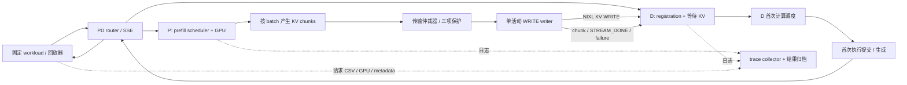

# PD 短请求优先 KV 传输系统：实现、验收与数据说明

更新日期：2026-11-06。工作目录：`/home/ubuntu/zjj/code`。

## 1. 最后实现了怎样的系统

当前实现是一个基于 **vLLM + NIXL 的单机双 GPU、Prefill/Decode 分离推理实验系统**。P 负责计算 prompt 的 KV，D 接收 KV 后生成结果。系统把 P→D 的 KV 传输拆成小 chunk，在每个 chunk 完成后重新选择下一个传输对象，使已经就绪的短请求有机会越过长请求，同时用次数、进度和累计等待三种保护约束长请求的饥饿。

系统同时包含请求路由、流式响应、错误取消、资源回收、确定性负载回放、阶段测量、逐 chunk 轨迹、GPU 采样和运行环境归档。已有整请求传输 baseline 和分块抢占两种运行模式。

已补齐请求阶段、整批完成时间和实验墙钟测量；完成固定负载对比、27 点保护参数搜索，以及新 baseline/默认/两候选各 3 轮确认。修复了随后定位的 long 握手越序/提前完成通知竞态；完整修复版本 baseline/默认/两候选各三轮，共 180/180 请求输出与直接参考一致。long 尾部代价仍超过既有 +10% 分析约束，未找到稳健可行推荐。当前回归为 **63 passed，14 warnings**；新结论见第 10 节开头，旧失败证据保留。

固定范围和环境：

| 项目 | 当前配置 |
| --- | --- |
| 拓扑 | 单 P、单 D，各占一张 RTX 4090；同一主机 |
| 并行与 KV 范围 | TP=1、PP=1、单 KV group，GPU KV 直接 WRITE |
| 模型 | `/home/ubuntu/zjj/models/Llama-3.1-8B-Instruct` |
| 软件 | Python 3.11.18、vLLM 0.32.0、Torch 2.13.0、NIXL/nixl-cu13 1.5.2 |
| CUDA | runtime 13.0，当前 nvcc 13.4.92；启动脚本记录工具链兼容参数 |
| 测试 | Conda `cc`，pytest 9.2.0；版本固定于 `requirements-test.txt` |
| 数值一致性 | P/D 默认 `VLLM_BATCH_INVARIANT=1`，两种模式使用相同配置；显式 0 用于旧内核诊断 |

不涵盖多节点、多 TP/PP、多 KV group、host offload 或生产规模验证。更换模型、软件版本、kernel 或拓扑后需要重新验收；本机已通过的工具链配置不等于覆盖所有 CUDA kernel 组合。

## 2. 模块与请求路径



一次请求的主要过程：

1. 回放器按照固定顺序、seed 和到达间隔向 router 发请求。router 为 P/D 构造相互关联的请求及传输参数；D 提前登记接收目标。
2. P 按计算 batch 产出新完成的 KV blocks，以固定 block 数切成 chunk。请求级映射、prefix offset 和传输总量跨 batch 保持一致。
3. worker 在交给后台 writer 前同步整个 CUDA 设备，覆盖可能在其他 stream 的 KV 写入。后台 writer 处理 registration、握手和 WRITE；握手等待也保留单传输槽，阻止后续 chunk 越过。
4. 一个 chunk 到安全完成边界后，仲裁器重新选择下一块。不会中断已经提交的 DMA。
5. D 用 chunk 序号和 final 判断接收完成；P 在所有 chunk 成功后额外发送请求级 `STREAM_DONE`，补偿逐 chunk 完成通知的遗漏。
6. D 完成 KV 接收后进入首次非空计算调度，EngineCore 提交执行，再将 token 经 router 流式返回。失败或取消走显式错误与 abort 路径，源块到安全边界才释放。

主要代码：

| 模块 | 职责 |
| --- | --- |
| `preemptive_transfer.py` | 分类、chunk 队列、仲裁、防饥饿状态与决策轨迹 |
| `push_scheduler.py`、`metadata.py` | 跨 batch chunk、请求级映射、P/D metadata、接收超时与完成生命周期 |
| `push_worker.py` | registration/握手、NIXL WRITE、通知、单活动句柄、取消和 lease 清理 |
| `vllm/v1/core/sched/scheduler.py` | 记录 D 首次非空计算调度 |
| `vllm/v1/engine/core.py` | 在普通 step 和 batch queue 执行入口记录 D 首次执行提交 |
| [run_pd_pair.sh](run_pd_pair.sh)、[run_pd_router.py](run_pd_router.py) | 启动 P/D、关联双端请求、SSE、上游失败归一化与取消 |
| [run_pd_load.py](run_pd_load.py) | 负载回放、TTFT/E2E、输出 hash、GPU 采样和 run metadata |
| [collect_pd_trace.py](collect_pd_trace.py)、[write_pd_run_environment.py](write_pd_run_environment.py) | 合并请求与 chunk 轨迹、完整性检查、环境归档 |
| [run_pd_sweep.sh](run_pd_sweep.sh) | baseline/preemptive 实验、健康等待、逐组清理、失败与分段总时间；支持外部 baseline，已用于 27 点扫描 |

前四个 connector 文件的实际安装目录为 `/home/ubuntu/miniconda3/envs/cc/lib/python3.11/site-packages/vllm/distributed/kv_transfer/kv_connector/v1/nixl/`。两个 core 文件和两个 worker 文件也在同一 site-packages 下。八个源码的相对目录结构完整保存在 [snapshots/vllm-preemptive-20261103/](snapshots/vllm-preemptive-20261103/)，与实际安装文件逐字节一致，并有 [SHA256SUMS](snapshots/vllm-preemptive-20261103/SHA256SUMS)。目录日期是最初建档日期，内容已更新至本轮；这八个文件并非完整 vLLM 源码发行包。

## 3. 调度功能与默认规则

| 功能 | 当前行为 |
| --- | --- |
| 请求分类 | short：原始 prompt tokens <256；long：>8192；其余 medium |
| 固定分块 | 默认 4 KV blocks；尾块可以更小；与 prefill batch 大小是不同参数 |
| short 越过 long | 仅在 chunk 边界、short 的 KV 已就绪、long 未受保护时发生 |
| medium | FIFO，形成插队屏障；short 不跨过 medium |
| 次数保护 | long 最多允许 3 次 short chunk 越过；按 chunk 计次 |
| 进度保护 | 成功传输块数 / D 实际缺失块数 ≥85% 后保护 long |
| 等待保护 | long 因 short 插队累计等待 ≥50ms 后，在下一仲裁边界恢复 |
| prefix cache | 按 D prefix offset 跳过命中块，传输进度仅计实际需要传输的成功块 |
| 空 chunk / final | 即使无需 WRITE，也明确传递序号和终止信息 |
| 重复通知 | 重复 summary 幂等处理，不重复完成或释放请求 |
| 失败恢复 | 取消、超时、握手失败、WRITE 错误和 worker 退出有显式失败与清理路径 |

等待保护不统计正常 prefill、registration 等待或 long 自身传输时间。阈值在下一次 chunk 仲裁时生效，因此 50ms 是保护阈值，不能保证在墙钟恰好 50ms 时中断当前 chunk。进度分母来自请求级实际传输需求，失败块、D 已命中块和空 final 不增加成功进度。

## 4. 解决了什么问题，如何解决

| 问题 | 处理方案 | 验证方式 |
| --- | --- | --- |
| 整请求传输占用通道，短请求等待长 KV | 固定 block chunk，在完成边界重新仲裁 | 真实 `preempt_long` 决策与 P/D chunk 轨迹 |
| 连续 short 可能使 long 饥饿 | 次数、85% 进度、累计等待三项保护 | 可控时间回归及持续 short、prefix-cache、50ms GPU 控制回放 |
| long 跨多个 prefill batch 后总量/偏移口径不稳定 | 请求级总 KV 映射稳定，各 batch 只提交新就绪块；prefix offset 按 D registration 对齐 | 跨 batch long、混合负载、连续两批与缓存场景 |
| WRITE 成功但 D 缺少完成序号，long 永久等待 | 保留逐 chunk 通知，全部成功后发送请求级 `STREAM_DONE` 汇总；失败不发成功 summary | 高 chunk 数 GPU 完成、重复 summary 和缺序号回归 |
| deferred 回调启动多个 WRITE，覆盖单活动句柄 | 仅在 `_stream_active is None` 时启动；其余保留在 deferred 队列 | 单槽回归、修复后 medium 全序号完成及连续两批成功 |
| D 接收完成误报为发送完成，导致块错误释放 | 区分完成方向，修正 completion 集合合并 | completion/lease 回归与混合 GPU 请求 |
| WRITE 可能读到尚未完成计算的 P KV | streaming path 提交后台传输前同步 CUDA stream | 同步边界后的 GPU 请求与输出 hash 对照 |
| prefix 命中仍被计入进度，85% 保护偏早 | 用 D 实际缺失 block 数作稳定分母，仅成功的未命中块计数 | 实际分母 179 blocks 的 GPU 保护轨迹 |
| 取消/失败后队列、句柄或 lease 滞留，迟到 chunk 再次入队 | 显式失败通知和 abort；拒绝取消后的 chunk；等待 scheduler 终态、活动 DMA 安全完成和 lease 登记后幂等回收 | WRITE 注入、D 主动取消、TTL 后无 expiry、后续 short 恢复 |
| registration 超时只存在于 scheduler，worker 无法结束接收 | metadata 下发 `push_failed_receives`，worker 转成接收失败并沿既有完成路径上报 | 0.5s watchdog 注入：long 500 后 short 200 |
| P 断连后 router 抛异常，D 可能持续等待 | 归一化连接失败；一侧失败显式调用另一侧 vLLM abort API | P worker 退出时 router 502、D abort 200，重启后 short 成功 |
| 精确 50ms 边界因浮点误差仍允许插队 | 等待比较加入极小容差 `1e-9 ms` | 49.999ms 允许，50.000ms 保护的可控时间回归 |
| 只有 D KV→首 token，无法拆出首次计算调度等待 | scheduler 首次非空调度与 EngineCore 执行提交分别记录同源 monotonic 时间，按请求仅记一次 | 新阶段回归、真实 GPU 每请求各一条事件、严格时序检查 |
| 以可变 `do_remote_prefill` 判定 D，首次执行日志漏记 | 用稳定 `remote_request_id` 及方向判定；排除 P 和空调度 | 覆盖 registration 清零该标志的测试，最终三个 D 请求均完整 |
| 缓存默认值与归档配置不一致 | false 显式传 `--no-enable-prefix-caching`，true 显式启用 | 最终组 P/D engine 日志与两个 JSON 均为 false |
| 测试只手工调用，缺乏统一结果归档 | 安装并固定 pytest，统一运行六个模块，保存文本与 JUnit | 初次 52 passed；加入尾 chunk/final lease 竞态回归后 57 passed，14 条 Torch 弃用 warning |

历史失败记录保留在计划书中。旧 cache sidecar 中的默认 false 可能只是脚本预期值，旧实验的实际缓存状态应以 engine 启动日志为准；不能把它们直接纳入缓存受控的正式性能对比。最终测量组已显式关闭缓存并完成交叉核对。

## 5. 最后一项测量限制如何闭环

过去只有 D KV 收齐到客户端首 token 的整体区间，其中混合了 scheduler 等待和计算返回过程。本轮增加两个直接事件：

- **首次计算调度**：scheduler 完成本轮调度选择后，请求第一次获得大于 0 的 `scheduled_tokens` 时记录 `PD first scheduled`。KV-only/空调度不记录。
- **首次执行提交**：EngineCore 在首次对应的 `execute_model()` 调用前记录 `PD first model submit`。普通 step 和 batch queue 两条入口均覆盖。

标记保存在 request 对象上，以免后续 decode step 重复记录；P 请求不记录。采用 host `time.perf_counter()`，同机进程的 monotonic 时间可以相减。跨机器比较需要另外处理时钟域，本次未扩展到该范围。

采集器保留原字段，并新增：

| 字段 | 含义 |
| --- | --- |
| `d_first_scheduled_monotonic_s` / `d_first_scheduled_tokens` | 首次非空计算调度的时间和本轮调度 token 数 |
| `d_first_model_submit_monotonic_s` / `d_first_model_submit_tokens` | 首次执行提交的时间和调度 token 数 |
| `d_kv_to_first_scheduled_ms` | D KV 收齐→首次调度，含接收完成传递、scheduler 等待等 |
| `d_schedule_to_model_submit_ms` | 调度选择→执行提交，含调度结果和 metadata 构造等 host 工作 |
| `d_kv_to_first_model_submit_ms` | D KV 收齐→首次执行提交 |
| `model_submit_to_first_token_ms` | 首次执行提交→客户端收到首个非空文本 token |

`--require-complete` 对 HTTP 200 请求要求 P final accepted/complete、D KV complete/final sequence、D 首次调度/提交全部存在，并检查 **KV≤调度≤提交**。最终验收另外检查每个首次事件恰好一次、提交≤客户端首 token，以及全部 chunk 序号和事件完整。

这些是 host 调度与提交时间，不是 GPU kernel 真正开始的时间。最后一个区间包含执行排队、GPU 计算、采样、IPC、router 和客户端传输。补齐首次调度的测量限制已经完成；纯 kernel 时间不属于本次指标定义。

## 6. 实际验收结果

### 6.1 最终三请求 GPU 测量组

证据目录：[logs/presweep-d-phases-20261105/](logs/presweep-d-phases-20261105/)。模式 preemptive，chunk=4、max preemptions=3、progress=0.85、wait=50ms；P/D 缓存显式关闭。并发 3、到达间隔 250ms、seed 77/78/79，每请求输出 8 tokens。

| 类型 | prompt tokens | HTTP | TTFT ms | E2E ms | KV→首次调度 ms | 调度→提交 ms | 提交→客户端首 token ms |
| --- | ---: | ---: | ---: | ---: | ---: | ---: | ---: |
| short | 68 | 200 | 380.119 | 495.973 | 3.720 | 0.286 | 27.378 |
| medium | 1107 | 200 | 569.067 | 685.410 | 3.371 | 0.232 | 24.881 |
| long | 10645 | 200 | 3783.618 | 3897.867 | 3.979 | 0.680 | 41.221 |

三个请求的文本输出 SHA256 均与 [baseline 请求结果](results/presweep-baseline/requests.csv) 一致。short/medium/long 分别有 2/18/167 个 chunk，共 187 个；所有 chunk 均有 P accepted/dispatch/start/complete、成功标志和 D receive，序号连续。三个请求首次调度与提交事件各一次，时序检查通过。

这些是单组原始测量，每类只有一个请求，不能用作稳定 P95/P99，也不能从本表推出短请求相对于 baseline 的性能改善。hash 相同证明本组指定输入的输出一致性，不等于所有输入的形式化正确性证明。

### 6.2 保护、失败和恢复证据

| 场景 | 已观察结果 | 数据目录 |
| --- | --- | --- |
| 次数保护 | long 被 short 越过 3 次后恢复；9/9 请求成功 | `logs/c-protect-20261105/` |
| 50ms 独立保护 | chunk=1、max preemptions=100、progress=1.0；49.907ms 仍插入 short，下一边界 56.690ms long 以 wait 原因恢复；9/9 成功、710 chunk | `logs/c-wait-50ms-20261105/` |
| prefix-cache 进度保护 | D 预热 8192-token 前缀；分母 179 blocks，152/179=84.916% 后下一边界 156/179=87.15% 触发 progress 保护，long 200 | `logs/c-prefix-85-20261105/` |
| 跨 batch / 重复请求 | 同一 P/D 组连续两批 short/medium/long 各 3/3 成功 | `logs/b1-deferred-repeat-20261105/` |
| registration 超时 | 0.5s watchdog，long 500；同组后续 short 200 | `logs/d-registration-timeout-20261105/` |
| WRITE 失败 | 注入 long seq=0 失败，返回 500；后续 short 200，TTL 后 expired reqs=0 | `logs/d-write-failure-verified-20261105/` |
| D 主动取消 | abort 200，迟到的 376 个 chunk 以失败完成丢弃；后续 short 200，TTL 后 expired reqs=0 | `logs/d-active-cancel-verified-20261105/` |
| worker 退出 | P 被终止，router 502，D abort 200；完整重启后 short 200 | `logs/d-worker-exit-fixed-20261105/` |
| router 一侧连接失败 | 显式调用 D abort，随后同一 D worker short 200 | `logs/d-abort-scaleout-20261105/` |

50ms 组两次决策的 6.783ms 间隔含不可中断的 short chunk 完成及 host 处理，不解释为纯 DMA 时间，也不等于超出 50ms 的差值。精确 85% 与 50.000ms 的边界由可控逻辑回归补充；GPU 证据说明真实 chunk 边界行为。

握手失败、重复通知、空 final、medium 屏障等还由逻辑回归覆盖，不能把每项都描述为独立 GPU 注入。上述历史组未记录本轮新增的首次调度/提交事件，应按当时的指标口径解读。

### 6.3 回归与清理

命令：`/home/ubuntu/miniconda3/envs/cc/bin/python -m pytest -q`。最新复跑结果 **63 passed, 14 warnings**（8.71s），warning 来自 Torch `torch.jit.script_method` 弃用提示。测试覆盖仲裁、completion/lease/失败清理、router、trace 合并、环境归档、D 首次调度/提交及 P/D 执行计时和请求结束校验，以及部分尾块、整块对齐、单 chunk prompt、跨 batch 尾块、重复 final、lease 登记竞态、流式 token ID/logprobs 审计。新增并发请求总时间回归；新增握手占槽、summary 等待前序完成和全设备同步先于入队回归；pytest.ini 限定 tests/ 避免归档同名模块冲突。最新文本和 JUnit 文件在 `logs/long-output-fix-20261106/`，60 项历史结果在 `logs/tuning-validation-20261106/`，旧 58 项位于 `logs/determinism-fix-20261106/`；早期 52 项结果保存在 `logs/presweep-execution-20261106/`。

新增源码及采集工具的 `py_compile`、`run_pd_pair.sh` 和 `run_pd_sweep.sh` 的 `bash -n` 检查通过。八个快照源码文件与实际安装内容一致。最终测量组的 P/D/router 均已结束，检查时没有 vLLM/router 服务或 GPU 计算进程残留。

## 7. 收集了哪些数据

### 7.1 数据文件与用途

以下最终测量文件均在 [logs/presweep-d-phases-20261105/](logs/presweep-d-phases-20261105/)：

| 文件 | 已保存内容 | 用途 |
| --- | --- | --- |
| `requests.csv` | 请求 ID、类别、prompt/output tokens、HTTP/错误、起始时刻、回放排队、router 收件、TTFT/E2E、seed 关联及输出 hash 等 | 对照请求是否成功、客户端时延和文本一致性 |
| `trace-request-phases.csv` | P final accepted/complete、D KV 收齐/final seq/完成方式、D 首次调度/提交、客户端首 token 及阶段差值 | 拆分传输后的 scheduler 与执行返回路径 |
| `trace-chunks.csv` | 请求/序号、块范围、final/success、P 接受/仲裁/开始/完成、D 收到、队列与处理时间、long 抢占数/进度/累计等待/保护原因 | 重建传输顺序、排查丢块、检查插队与保护 |
| `gpu.csv` | 采样时间、GPU index、利用率、显存 MiB | 观察运行期间设备状态；采样并非 kernel profiler |
| `load.json` | 成功率、吞吐、分类延迟统计、失败/超时统计，成功和失败时延分开 | 单组执行摘要；本组样本量不足以解释尾分位数 |
| `run.json` | workload 路径和 SHA256、类别顺序、seed、并发、到达间隔、stream、设备/端口/参数及环境文件位置 | 复现到达过程和运行配置 |
| `environment.json` | Python/vLLM/Torch/NIXL/pytest、CUDA/nvcc/driver、GPU UUID 与映射、模型、缓存和调度参数 | 校验软件、设备与配置一致性；不保存 API key 明文 |
| `prefill.log` / `decode.log` / `router.log` | 启动配置、P/D 协议事件、仲裁与故障信息、首次调度/提交事件、router 时间 | 追查 CSV 对应的原始事件和真实生效配置 |
| `launch.txt`、PID 文件 | 启动信息与当次服务 PID | 对应本组进程；进程退出后 PID 文件仅作历史记录 |
| `trace-collection.txt` | 严格采集命令结果 | 证明新版本必需事件检查通过 |
| `verification.json` | hash 对照、187 chunk 完整性、事件次数/顺序、缓存与 workload 校验结果 | 最终独立验收摘要 |
| `pytest.txt` / `pytest-junit.xml` | 52 项回归的文本与机器可读结果 | 保存测试证据 |

固定输入是 [workload.pre-sweep.jsonl](workload.pre-sweep.jsonl)，SHA256：`c88cac6bf56d7474624a8875ecf3b0efddd44f558fb702a6ae94688fa22ac55f`。seed 列表在 `run.json`，完整请求输入在 workload，不能只凭 prompt token 数复现文本输入。

此外，失败注入、50ms 与 prefix-cache 保护数据分别保存在第 6 节所列目录。固定两组实验已保存每组 `status.json`、`trace-request-metrics.csv`、`trace-execution.csv`、phase/chunk CSV、GPU 采样和环境日志；`comparison.json` 与 `comparison-request-metrics.csv` 提供对齐后的比较。此前两组固定 workload 对比为历史证据；新增 27 点扫描及重复确认见第 10 节。

严格采集模式要求成功请求具有 TTFT、E2E、回放提交到结束的时间、P/D host 执行累计及正常结束事件。固定两组已有日志已用更新后的门槛重新校验通过。CUDA forward 辅助事件在这两组 worker 日志中未产生，其字段为空，不能当作零或 GPU kernel 时间。

### 7.2 指标口径

| 指标 | 定义与解释 |
| --- | --- |
| 客户端 TTFT | 回放器开始该次请求到收到首个非空文本片段；包含网络与 router 路径 |
| E2E / `latency_ms` | 客户端一次请求完整结束的时长 |
| 请求 `queue_ms` | 回放线程池的排队时间；与 router 收件时刻分开记录 |
| P final accepted | 最终 chunk 进入 worker/writer 的 host 侧时刻；不是精确的 prefill GPU kernel 结束时刻 |
| `p_final_chunk_ready_to_d_kv_complete_ms` | 为兼容保留的字段名，实际起点是 P final accepted，终点是 D KV 收齐；不是整个请求的总传输时间，可能此前已传出多个 chunk |
| P final complete | P writer 观察并处理最终 chunk 完成的时刻 |
| D KV receive complete | D worker 确认完整接收/final 的事件；scheduler 可能在后续步骤才消费该完成信息 |
| chunk `queue_ms` | accepted→arbiter dispatch，包含等待 registration/计算后续 chunk 等可能影响，不能统一归因于插队 |
| chunk `transfer_ms` | host 记录 start→complete，含传输准备、DMA 与完成轮询等开销；不作为纯 DMA 带宽测量 |
| 仲裁 `long_wait_ms` | 仅 long 被 short 插队造成的累计等待，按规则累计 |
| 工作量 | 以 KV block 数计数，未单独换算并实测字节带宽 |

P 完成回调与 D 接收通知异步处理，D 完成日志可能早于 P host 完成日志；这不表示 D 在 DMA 未完成时计算。验收检查的是 D 自身 KV→调度→提交→首 token 的顺序，不强制两个进程的 host 回调先后相同。

## 8. 如何复查与复现单组实验

已有数据可以直接复查，无需重新启动 GPU：

```bash
cd /home/ubuntu/zjj/code
/home/ubuntu/miniconda3/envs/cc/bin/python -m pytest -q
/home/ubuntu/miniconda3/envs/cc/bin/python collect_pd_trace.py \
  --requests logs/presweep-d-phases-20261105/requests.csv \
  --prefill-log logs/presweep-d-phases-20261105/prefill.log \
  --decode-log logs/presweep-d-phases-20261105/decode.log \
  --output-prefix logs/presweep-d-phases-20261105/trace \
  --require-complete
```

重新运行时，先确认八个快照修改已应用于对应版本的 cc 环境、GPU 空闲、端口未占用，使用新的 `RUN_DIR` 保留既有证据。下例使用默认端口 P=8100、D=8200、side-channel=5600/5601、router=8000；最终已归档那组使用的是 8110/8210、5610/5611、8010，不能混用。

```bash
cd /home/ubuntu/zjj/code
export PYTHON_BIN=/home/ubuntu/miniconda3/envs/cc/bin/python
export RUN_DIR="/home/ubuntu/zjj/code/logs/manual-phases-$(date +%Y%m%d-%H%M%S)"
export MODEL=/home/ubuntu/zjj/models/Llama-3.1-8B-Instruct
export MODE=preemptive ENABLE_PREFIX_CACHING=false
export P_PORT=8100 D_PORT=8200 P_DEVICE=0 D_DEVICE=1
export P_SIDE_CHANNEL_PORT=5600 D_SIDE_CHANNEL_PORT=5601
export CHUNK_SIZE_BLOCKS=4 LONG_REQUEST_MAX_PREEMPTIONS=3
export LONG_REQUEST_PROTECT_PROGRESS=0.85 LONG_REQUEST_MAX_PREEMPT_WAIT_MS=50
bash run_pd_pair.sh > "$RUN_DIR-launch.txt" 2>&1
```

分别等待 `http://127.0.0.1:8100/health` 与 `http://127.0.0.1:8200/health` 返回 200，再启动 router。首次模型加载/JIT 可能耗时，需查看本组日志，不能只等待固定几秒就开始发请求。

```bash
export P_ENDPOINT=http://127.0.0.1:8100/v1/completions
export D_ENDPOINT=http://127.0.0.1:8200/v1/completions
export ROUTER_PORT=8000
"$PYTHON_BIN" run_pd_router.py > "$RUN_DIR/router.log" 2>&1 &
PD_REPORT_ROUTER_PID=$!
printf '%s\n' "$PD_REPORT_ROUTER_PID" > "$RUN_DIR/router.pid"
```

等待 router `/health` 200 后，在同一 shell 回放并采集：

```bash
"$PYTHON_BIN" run_pd_load.py \
  --workload workload.pre-sweep.jsonl \
  --endpoint http://127.0.0.1:8000/v1/completions \
  --output "$RUN_DIR/requests.csv" \
  --concurrency 3 --interarrival-ms 250 --timeout 120 \
  --stream --sample-gpu --run-metadata "$RUN_DIR/run.json" \
  > "$RUN_DIR/load.json"
"$PYTHON_BIN" collect_pd_trace.py \
  --requests "$RUN_DIR/requests.csv" \
  --prefill-log "$RUN_DIR/prefill.log" --decode-log "$RUN_DIR/decode.log" \
  --output-prefix "$RUN_DIR/trace" --require-complete
```

检查三个输出 hash、逐请求事件次数、chunk 序号和时序，再停止本组服务。`run_pd_pair.sh` 启动后会返回，手工复现必须清理它创建的 API server 及子进程；以下按本组 PID 递归发送 TERM，不按进程名批量结束其他任务：

```bash
pd_report_stop_tree() {
  local pd_report_pid="$1" pd_report_child
  while read -r pd_report_child; do
    pd_report_stop_tree "$pd_report_child"
  done < <(pgrep -P "$pd_report_pid" || true)
  kill -TERM "$pd_report_pid" 2>/dev/null || true
}
for pd_report_pidfile in "$RUN_DIR/router.pid" "$RUN_DIR/prefill.pid" "$RUN_DIR/decode.pid"; do
  pd_report_stop_tree "$(cat "$pd_report_pidfile")"
done
nvidia-smi --query-compute-apps=pid,process_name,used_memory --format=csv
```

等待本组进程和 GPU 占用释放后才启动下一组。手工命令应在异常退出时同样执行清理；自动 sweep runner 已有按组清理和信号处理。该节原固定 7/1/2 workload 对比保留；本次新增固定 15 请求的 27 点扫描及重复确认见第 10 节。

## 9. 固定负载两组对比结果

本节先列出的 `results/sweep-fixed-7s1m2l/` 是尾部 KV chunk 修复前的历史结果；修复后的最终复验见本节末尾。两次均使用同一固定输入，但结果目录互不覆盖。

实验目录：[results/sweep-fixed-7s1m2l/](results/sweep-fixed-7s1m2l/)。输入 [workload.sweep-fixed-7s1m2l.jsonl](workload.sweep-fixed-7s1m2l.jsonl)，SHA256 `0e42aeac323527a70a50214fe84f5d3ecae093ff0a04ea13c683d44b8bdaeac2`。两组使用相同请求顺序、seed、到达间隔 100ms、并发 10、P/D 显式关闭 prefix caching；baseline 为 preemptive transfer 关闭，抢占组为 chunk=4、max preemptions=3、progress=0.85、wait=50ms。

| 类别 | n | baseline TTFT mean (ms) | preemptive TTFT mean (ms) | baseline E2E mean (ms) | preemptive E2E mean (ms) |
| --- | ---: | ---: | ---: | ---: | ---: |
| short | 7 | 357.110 | 324.038 | 474.907 | 441.814 |
| medium | 1 | 598.786 | 1338.861 | 715.009 | 1453.599 |
| long | 2 | 7197.172 | 7272.452 | 7311.865 | 7386.724 |

P/D host 执行均值（ms）：short 的 prefill/decode 为 baseline `29.874/256.667`、preemptive `30.164/261.603`；medium 为 `120.872/251.079`、`325.408/251.932`；long 为 `2742.312/274.085`、`2693.480/276.756`。两组均 10/10 HTTP 200，逐请求输出 hash 一致。抢占组生成 396 行 chunk 轨迹，包含 23 个 `dispatch_short`、18 个 `dispatch_fifo`、304 个 `dispatch_long` 和 51 个 `protected_resume`；baseline 关闭抢占，因此不生成 arbiter chunk 轨迹。

完整逐请求指标在 `comparison-request-metrics.csv`，聚合和差值在 `comparison.json`；各组原始 `requests.csv`、`trace-request-metrics.csv`、`trace-execution.csv`、phase/chunk CSV、GPU 采样、logs、run/environment/status JSON 均保留。单次、每类样本量为 7/1/2，结果只能作为该固定 workload 的描述性对比，不能作为稳定 P95/P99 或因果性能证明。medium 只有一个样本，long 只有两个样本。

### 尾部 KV chunk 延迟修复后的最终复验

medium 的 prompt 为 1107 tokens，对应 70 个 KV blocks，而 chunk 大小为 4。旧逻辑只在 batch 后排入完整 chunk，最后 2 个 block 一直等到 `request_finished()` 才提交；long 的 chunk 已进入 writer 队列时，medium 尾段就会落在 long 后面。这是 medium 本次异常延迟的具体队列原因，也说明 scheduler 对“已在计算中的请求优先”并不能代替 transfer writer 中正确的 FIFO 入队顺序。

现在 prompt KV 全部就绪的计算 batch 会立即排入不足 4 blocks 的尾 chunk，并标记 final；block 数整除时排入空 final marker。`_stream_final_queued` 避免请求结束回调重复发 final。push worker 还会暂存“final 传输先完成、scheduler final lease metadata 后登记”的完成事件，等 lease 登记后再完成清理，避免异步竞态。

回归测试覆盖部分尾块、整块对齐、单 chunk prompt、尾块跨 batch、重复 final 和 lease 登记竞态，最终 `57 passed, 14 warnings`。修复后的固定 workload 结果位于 [results/sweep-fixed-7s1m2l-tailfix-final/](results/sweep-fixed-7s1m2l-tailfix-final/)，两种模式均 10/10 请求成功，逐请求输出 hash 一致。medium seq=0..17 的 18 个 chunk 全部成功；尾 chunk seq=17 为 block_start=68、blocks=2、final=true。medium 尾 chunk 的 dispatch 时间为 `11743.467829`，早于 long 首 chunk 的 `11743.481216`，直接验证尾块没有排到 long 后面。

| 类别 | n | baseline TTFT mean (ms) | preemptive TTFT mean (ms) | baseline E2E mean (ms) | preemptive E2E mean (ms) |
| --- | ---: | ---: | ---: | ---: | ---: |
| short | 7 | 291.204 | 292.954 | 409.270 | 410.755 |
| medium | 1 | 800.946 | 591.318 | 916.921 | 707.595 |
| long | 2 | 6708.201 | 6506.636 | 6826.558 | 6623.338 |

本次 medium 的 P host prefill 执行时间为 baseline `118.675 ms`、preemptive `315.768 ms`。这个字段包括 host 侧调度和执行等待；本次没有 CUDA forward 事件，不能把它视为纯 GPU 计算耗时，也不能据此推断 prefill GPU 工作量变大。以上每种模式只运行一次，medium 只有一个样本；结果说明这次尾块顺序正确且该次延迟下降，不构成稳定性能收益或普遍因果结论。逐请求指标、完整轨迹和比较结果均保存在最终结果目录。

### 后续重复运行

用户要求对相同的 10 请求固定输入再运行一次。新数据单独保存在 [results/sweep-fixed-7s1m2l-rerun-20261106-1111/](results/sweep-fixed-7s1m2l-rerun-20261106-1111/)；workload checksum 与前两组相同，runner 配置为并发 10、100ms 间隔、prefix caching=false。baseline 和 preemptive 均 status=passed、10/10 HTTP 200，逐请求响应 hash 全部一致，执行 trace 收集成功。

| 类别 | n | baseline TTFT mean (ms) | preemptive TTFT mean (ms) | baseline E2E mean (ms) | preemptive E2E mean (ms) |
| --- | ---: | ---: | ---: | ---: | ---: |
| short | 7 | 329.619 | 314.239 | 446.319 | 431.642 |
| medium | 1 | 801.538 | 606.365 | 917.626 | 722.007 |
| long | 2 | 7486.491 | 7499.243 | 7619.019 | 7607.283 |

本轮 medium 的 P host prefill 执行时间为 baseline `118.633 ms`、preemptive `320.125 ms`；decode 执行时间为 `251.533/252.211 ms`。host prefill 包括 host 调度和执行等待，不能解读为 GPU kernel 时间；CUDA forward 字段为空。本轮 393 个抢占轨迹 chunk 的决策数为 `dispatch_short=20`、`dispatch_fifo=18`、`dispatch_long=304`、`protected_resume=51`。完整逐请求结果见 `comparison-request-metrics.csv`，聚合结果见 `comparison.json`。

这次重复运行再次观察到 medium TTFT/E2E 较低，但 medium 每种模式仍只有一个样本，不能据此得出稳健的统计或因果结论。实验目录保留 load、requests、trace、GPU 采样、日志、环境和状态文件。

### 交错 15 请求旧内核实验

为观察更密集且交错的到达过程，新增 workload `workload.sweep-interleaved-8s3m4l.jsonl`，包含 8 short、3 medium、4 long，顺序为 `short/long/short/medium/short/long/short/long/short/medium/short/long/short/medium/short`。short、medium、long prompt 分别为 128、1107、10000 tokens；固定 workload SHA256 为 `714990980c49534e539a125612ce1c8d36c68ac75a559e4bce93dabcb7ee9e14`。实验目录为 [results/sweep-interleaved-8s3m4l-20261106/](results/sweep-interleaved-8s3m4l-20261106/)。

baseline 和 preemptive 都是 15/15 HTTP 200，trace 完整。注意：请求 `interleaved15-07-long` 两组都生成 8 tokens，但响应 hash 不同。因此这轮实验未通过“所有输出 hash 一致”的正确性门槛；下面的延迟只能作为运行时观测，不能作为两模式完全等价的性能对比。

| 类别 | n | baseline TTFT mean (ms) | preemptive TTFT mean (ms) | baseline E2E mean (ms) | preemptive E2E mean (ms) |
| --- | ---: | ---: | ---: | ---: | ---: |
| short | 8 | 10510.157 | 7760.496 | 10638.957 | 7865.127 |
| medium | 3 | 12325.034 | 11715.140 | 12458.526 | 11832.039 |
| long | 4 | 11851.976 | 10706.901 | 11979.459 | 10822.481 |

preemptive 的 698 行 chunk 轨迹包含 `dispatch_short=8`、`dispatch_fifo=54`、`dispatch_long=300`、`protected_resume=328` 和 `preempt_long=8`。P host prefill 执行均值（baseline/preemptive ms）为 short `425.705/383.729`、medium `507.984/464.764`、long `2369.295/2452.524`；这是含 host 调度/等待的共享 batch 口径，CUDA forward 事件为空，不能解释为纯 GPU 计算时间。

本次交错负载显示抢占模式下三类请求的均值都较低，但单轮实验仍会受到动态 batch、到达时序和请求间排队影响；更关键的是存在一个输出 hash 差异，必须先调查确定性/数值差异，再把这轮结果用于严格性能结论。

### 动态 batch 差异调查、处理与最终复验

上述差异随后完成调查，完整证据在 [INVESTIGATION_REPORT.md](results/determinism-investigation-20261106/INVESTIGATION_REPORT.md)。旧内核 PD 复跑在相同 long 上再次出现 token 分叉：两组生成前缀 `[1121,1715,40370]` 相同，第 4 个 token 分别为 864 和 2532。baseline 中多个 top logprobs 并列，preemptive 中 2532 排到首位，之后自回归输出分叉。另有不含 KV 传输的 solo/mixed 控制共 64 条响应：默认内核会随 batch/prefill 布局改变 logprobs；启用 batch-invariant 后目标 long 的四次控制，token 和 top logprobs 都相同。原始运行只保存 hash，不能事后确认其精确分叉位置；第 4 token 的证据来自诊断复跑。

处理使用 vLLM 已有的 `VLLM_BATCH_INVARIANT=1`：对矩阵计算和 attention 采用不随 batch 组成改变数值行为的路径，而不靠删除 seed、强制串行或关闭动态 batch 掩盖差异。P/D 和 sweep 默认启用该配置，环境文件保存实际开关。greedy 与固定 seed 控制采样，不能单独约束浮点执行路径。两种模式都使用相同内核配置；新实验额外开启 top-5 logprobs 审计，其开销在两组相同，不能将新旧内核的绝对延迟差直接归因于传输策略。

采集器现在保存实际文本、token ID，可选保存 top logprobs。单参数两组 sweep 除 HTTP/trace 验收，还自动比较 token ID 与文本 hash；不一致时整体返回非零。每组的 status=passed 仍只表示该组 HTTP/trace 成功，跨模式正确性由 `comparison.json` 单独记录。`summarize_pd_experiment.py --reference` 还可对照不经过 KV 传输的参考结果。

最终数据在 [sweep-interleaved15-invariant-verified-20261106/](results/sweep-interleaved15-invariant-verified-20261106/)。输入、顺序、间隔和抢占参数保持与原 15 请求组相同；baseline/preemptive 均 15/15，runner 退出 0，所有生成 token ID 和文本 hash 相同，并且全部匹配直接推理参考。这为本固定数据集提供了输出一致性验收，没有进行逐层逐字节 KV 比较，不代表已证明所有通用场景正确。

| 类别 | n | baseline TTFT mean (ms) | preemptive TTFT mean (ms) | baseline E2E mean (ms) | preemptive E2E mean (ms) |
| --- | ---: | ---: | ---: | ---: | ---: |
| short | 8 | 12023.799 | 7872.614 | 12282.129 | 8089.025 |
| medium | 3 | 14477.230 | 11586.769 | 14776.925 | 11852.239 |
| long | 4 | 14299.549 | 10666.057 | 14614.328 | 10988.990 |

平均值并不能描述所有代价。最后一个 short E2E 从 `14594.524` 增至 `17694.020ms`，整轮回放从 `18.083` 增至 `19.121s`。该策略改变完成顺序：让部分请求更早结束，medium 屏障和 long 保护仍可能使后面的 short 等待更久。

本轮出现 8 次按 chunk 计数的 short 越过 long：`02-short→01-long`、`06-short→05-long`、`08-short→07-long`、`12-short→11-long`，每对两次。相对回放开始时间分别约为 `1.280/1.305`、`4.703/4.726`、`9.027/9.058`、`13.931/13.959s`。01-long 首先以 85.12% 进度进入保护；05/07/11-long 首先在累计等待 50.652/61.029/57.362ms 的仲裁边界进入保护。共有 494 条 protected_resume，表示受保护 chunk 的重复选择记录，不是独立保护恢复次数。50ms 不是整个请求或 TTFT 的上限。

完整复现命令、源码 hash、逐请求四项指标及输出证据保存在最终目录。发生过程单独提供 [EXPERIMENT_REPORT.md](results/sweep-interleaved15-invariant-verified-20261106/EXPERIMENT_REPORT.md)、`preemptions.csv`、`protection-decisions.csv`、`request-timeline.csv`、含 4429 条事件的 `experiment-timeline.csv` 及 [timeline.html](results/sweep-interleaved15-invariant-verified-20261106/timeline.html)。时间线区分 arbiter 选择与实际 WRITE start/complete，保留各组相对时间和原始 monotonic 时钟。

中间 invariant 运行虽完成请求/trace，但运行中修改 runner 导致其收尾退出 2，保留为中间证据。最终 verified 组从固定脚本重新完整运行，退出 0；不能把中间运行与最终验收混用。

## 10. 当前交付状态与尚未作出的结论

### long 输出差异修复与最新复测

- 根因证据：旧默认第二轮 01-long 的 seq 0～24 在握手期间未占住单传输槽，被 seq 25～156 越过；final 完成即发 `STREAM_DONE`。D 在 monotonic `20375.180449` 宣布收齐，而前 25 个 chunk 的实际 WRITE 到 `20388.002192` 才开始、`20388.542013` 才全部完成，导致用不完整 KV 生成。该问题独立于 batch-invariant 数值内核。
- 修复 `push_worker.py`：握手至 deferred WRITE 启动/失败期间保留传输槽；全部 chunk 的 WRITE/notification 成功后才允许 summary，保存真实 final 序号；入队前全设备 CUDA 同步保证可能在其他 stream 的 KV 写入完成，并记录同步耗时。后者为保守可见性保护，不将它单独认定为已观测失败的根因。
- 固定原 15 请求和输入 hash，baseline、85%/3/50ms、95%/5/50ms、95%/5/100ms 各三轮完整修复验证：**180/180 HTTP、文本 hash、token ID 均与直接参考一致**；抢占组逐请求 chunk 成功完成顺序连续递增。pytest **63 passed、14 warnings**。8 个 runtime 文件与快照一致，SHA256SUMS 已更新。
- 最初 repeat-1 的 95%/5/50ms 在完整修复前启动，原数据保留但从最终分析排除；在 supplement/ 下单独补跑，仍与原 repeat-1 baseline 配对，补跑非相邻执行的漂移限制已注明。`retests/confirmation-results.json` 保留原始 runner 汇总，最终以 [fixed-results.json](results/long-output-fix-20261106/fixed-results.json) 的版本筛选结果为准。

| 配置（进度/次数/等待） | 整批 mean[min,max](s) | long E2E 观测最大值(ms) | 最差单 long 相对配对 baseline |
| --- | --- | ---: | ---: |
| baseline | 15.250 [13.685,18.099] | 16457.044 | — |
| 85% / 3 / 50ms | 18.237 [17.074,18.948] | 17225.512 | +35.40% |
| 95% / 5 / 50ms | 18.000 [16.609,18.974] | 17292.835 | +32.26% |
| 95% / 5 / 100ms | 18.544 [18.177,19.148] | 17469.614 | +39.04% |

- 95%/5/50ms 的 short/medium TTFT 几何均值分数中位数最低（8927.337ms），抢占配置中整批均值也最低；baseline 整批均值仍最快。**没有抢占配置通过原先每条 long E2E≤baseline+10% 的约束，默认保持不变。**每配置只有 12 条 long 观测，报告最大值而非声称稳定 P95/P99。
- 每个抢占组均发生 8 次 short chunk 越过 long。每组 23 次设备同步，host 阻塞累计约 4.23～4.38s，单次最大约 225～230ms；包含等待已提交计算，不能直接当作新增 GPU 时间或将累计值加到 E2E。握手串行化、分块控制开销和保守同步可能影响 long 尾部，本轮未做消融归因。
- 完整证据：[FIX_REPORT.md](results/long-output-fix-20261106/FIX_REPORT.md)、`paired-long-e2e.csv`、`preemption-summary.json`、各候选的逐请求四项指标、抢占表、保护表、完整时间线和 `timeline.html`。新增 [report_pd_long_output_fix.py](report_pd_long_output_fix.py) 可重建最终版本筛选/对照报告，源码和校验和同目录归档。原失败与旧 27 点不改写；本次关闭已复现的竞态问题，不宣称任意 workload 已无错误。

### 历史：总时间测量与保护参数实验（修复前）

每请求 E2E 不能相加当作整批耗时，因为请求并发且执行区间重叠。新增 `collect_pd_total_time.py` 明确计算：

| 总时间字段 | 定义 | 用途 |
| --- | --- | --- |
| workload_makespan_s | 最早客户端发出 HTTP 请求→最后响应正常/失败结束 | 这 15 个请求的整批完成时间，含到达间隔与内部排队，排除模型启动 |
| first_submission_to_last_finish_s | 最早回放提交→最后响应结束 | 额外包括回放线程池的首请求排队 |
| client_replay_elapsed_s | 回放器启动计时→收集完 futures/采样器收尾 | 保留旧 elapsed_s；与 workload makespan 接近但非同一边界 |
| group_wall_s | 单参数点服务启动前→本组 router/P/D 清理结束 | 实验操作总时间，含启动、健康检查、15 秒空闲等待、回放、trace 和清理 |
| total_sweep_wall_s / total_grid_wall_s | 单次 runner / 全网格最外层起止 | 记录实验资源时间成本，与请求吞吐区分 |

同时输出 successful_requests_per_s = 成功请求数 / workload_makespan_s。失败请求不会从最后结束边界删除，也不进入成功数。旧 verified 实验可由原始请求时间戳精确补算 workload makespan：baseline `18.079571s`、默认 preemptive `19.116744s`，吞吐分别 `0.829666/0.784652 req/s`，与此前约 `18.083/19.121s` 的回放 elapsed_s 定义不同。补算数据放在 `results/sweep-interleaved15-original-total-times.json`/CSV；旧 runner 没有采集从启动到清理的墙钟，不使用文件 mtime 虚构该值。

- 输入保持不变：8 short/3 medium/4 long，原交错顺序及 seed，SHA256 `714990980c49534e539a125612ce1c8d36c68ac75a559e4bce93dabcb7ee9e14`；并发 15、到达间隔 100ms、chunk=4、prefix cache=false、batch-invariant=1。
- 新增 `collect_pd_total_time.py`，自动记录首个 HTTP 发出→最后响应结束的 `workload_makespan_s`、成功请求/秒，另保留回放 elapsed；`experiment-timing.json` 记录每组服务启动→清理的墙钟和分段，runner/网格有外层总计时。请求并发，不能把逐请求 E2E 相加当整批总时间。旧 verified 组精确补算为 baseline `18.079571s`、默认抢占 `19.116744s`，独立保存在 `results/sweep-interleaved15-original-total-times.json`/CSV；历史启动/清理未计时，不伪造。
- 已完成 27 点：次数={1,3,5}、进度={70%,85%,95%}、累计等待={25,50,100}ms。27 组均完成 15/15 HTTP，25 组输出一致、21 组满足初筛 long 约束。一个启动超时保留并补跑，两个输出失败原样保留且排除，未用重跑覆盖。网格墙钟含失败、补跑与阶段间操作 `2710.862s`。证据：[网格报告](results/tune-interleaved15-20261106/TUNING_REPORT.md)、[交互比较](results/tune-interleaved15-20261106/tuning-dashboard.html)。
- 首轮只作候选筛选：历史 baseline 开启 top-logprobs，新网格关闭；最终另用统一关闭审计的新 baseline、默认与两个候选各做 3 轮，循环调整执行顺序，共 12 组/180 请求，每组重启 P/D。确认阶段 `1102.178s`，搜索开始至最后确认组结束共 `3837.703s`（约 63.96 分钟，包含阶段间分析）。
- 目标为 short/medium 类均值 TTFT 几何平均，复测按三轮分数中位数选择；正确性和每条 long 相对同轮 baseline 的 E2E ≤+10% 为准入条件。10% 是本轮分析约束，不是用户 SLA 或系统保证。**没有抢占配置同时通过三轮全部约束，不能宣布已找到稳健最优参数。**

| 配置（进度/次数/等待） | short TTFT mean(ms) | medium TTFT mean(ms) | 整批总时间 mean[min,max](s) | 三轮输出校验 | 最差单 long E2E 变化 |
| --- | ---: | ---: | --- | --- | ---: |
| baseline | 11207.964 | 12338.227 | 15.445 [13.480,19.220] | 通过 | — |
| 85% / 3 / 50ms（默认） | 7803.730 | 10483.312 | 17.384 [17.034,17.789] | 第二轮一条失败 | +30.27% |
| 95% / 5 / 50ms | 8430.164 | 12443.526 | 20.136 [18.461,21.966] | 通过 | +60.95% |
| 95% / 5 / 100ms | 7061.427 | 11061.469 | 18.006 [16.728,18.841] | 通过 | +33.95% |

- **有条件的观测结果：95%/5次/100ms 是三轮输出均正确的已测候选中延迟分数最低者，不能称为满足 long 约束的推荐。**其分数中位数 9076.415ms，默认观测 8904.451ms（但默认含失败轮），因此它也没有证明全面优于默认。若优先整批完成时间，三轮平均 baseline 最低。通用默认仍 85%/3/50ms；保留默认不代表它已通过本次所有正确性验收。
- 每个抢占配置每轮均发生 8 次 short chunk 插队；95%/5/100ms 有单个 long 被越过 4 个 chunk，而另两配置每条 long 至多 2 次。100ms 允许更长的插队窗口，50ms 更容易先触发等待保护；相同插队总数也可形成不同顺序与长请求代价。进度、次数和等待是 OR 关系，未证明三个连续参数的全局最优。
- **仍有残余正确性问题：**网格 `c4-p1-x0.95-w100`、`c4-p5-x0.70-w50` 及确认第二轮默认的 `interleaved15-01-long` 输出与参考不同，均在 batch-invariant=1 下发生。确认默认实际 token `[8481,1715,8481,1715,8481,1715,8481,1715]`，参考 `[1121,1715,8481,1715,1121,6636,1121,8481]`。根因未定位，不能宣称所有调度组合均确定或系统无错误；失败证据保留于 `output-failures.json`。此前旧四次控制及 verified 单轮通过仍成立，但不构成通用保证。
- 最终完整报告：[FINAL_TUNING_REPORT.md](results/tune-interleaved15-confirmation-20261106/FINAL_TUNING_REPORT.md)。确认目录有 `confirmation-summary.csv`、`workload-total-times.csv`、`paired-long-e2e.csv`、`preemption-summary.json`、`final-decision.json`；每个 repeat/配置下均生成与同轮 baseline 配对的请求指标、`preemptions.csv`、保护表、完整事件 CSV 和 `timeline.html`。默认失败轮的配对报告明确失败，其余 8 对通过。
- 最新验证：`60 passed, 14 warnings (8.86s)`，证据 `logs/tuning-validation-20261106/`。八个运行时文件与源码快照 hash 一致；固定输入 hash 未变；实验服务与 GPU 计算进程已清理。测量与实验已完成，残余输出差异及满足 long 约束的稳健选参仍未解决。

已完成固定范围内的分块传输、短请求优先、三项 long 保护、跨 batch/prefix-cache bookkeeping、成功/失败/取消生命周期、流式回放、精确 host 阶段测量和归档。最后的首次调度测量缺口已由代码、回归和真实 GPU 数据共同闭环，计划书同步更新。

固定 workload 的两组对比、27 点保护参数扫描与 12 组确认已经完成；仍未估计稳定分位数、扫描 chunk 或运行 chunk FIFO 对照，不能给出普适性能结论。旧输出不一致保留为历史证据；当前已修复确认阶段可直接定位的握手/summary 竞态，完整修复版本重复验证输出一致，仍不把有限负载测试扩展为所有场景的正确性证明。

执行状态和完整历史证据见 [PD_PREEMPTIVE_TRANSFER_PLAN.md](PD_PREEMPTIVE_TRANSFER_PLAN.md)。
