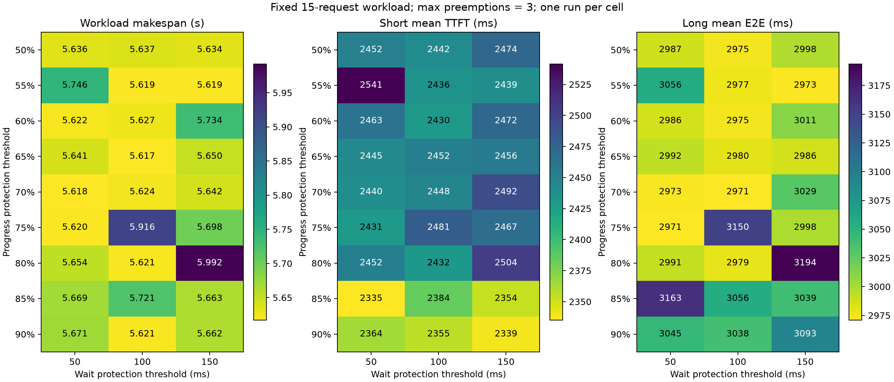

# 27 组进度/等待阈值参数扫描

本轮按整批完成时间选择的观测最优组合为 **65% / 3 次 / 100ms**，整批 **5.617276s**；相邻两次新 baseline 均值 **6.169726s**，降低 **8.95%**。每个组合仅运行一次，这是本次扫描的最小观测值，尚未通过重复实验确认稳健最优。

## 固定条件与对照方法

- 原测试集不变：15 请求（8 short × 128 tokens，3 medium × 1107，4 long × 10000），各输出 8 tokens；到达间隔 100ms，并发 15。
- 仅比较整请求 NIXL baseline 与完整方案；完整方案三模块全开，short/medium 各请求每计算 batch 聚合，long C8。
- 进度保护阈值为 50%～90%，每 5% 一档；等待阈值 50/100/150ms；最大抢占次数固定为 3。共 27 候选，不做消融。
- 比例指 long 已成功传输 blocks / 总 blocks，达到比例后禁止继续插队；等待指因抢占插队累计等待，并非排队总时长。
- 两种模式都使用 UCX TCP TX/RX 128KB、WRITE 单槽、event fence、batch invariant、关闭 prefix cache；同模型、GPU、请求/seed/顺序。
- 固定随机种子 20261106 打乱 27 个候选顺序，每 9 个候选前后各有新 baseline，合计 4 次 baseline、31 组服务启动。每个候选相对所在 9 点区间两端 baseline 均值计算收益。
- 主指标为从首个请求提交到最后响应结束的 workload makespan；不将服务启动与固定 15s 等待混入该指标。逐组启动/清理墙钟另保存在原始结果。
- workload SHA256：`714990980c49534e539a125612ce1c8d36c68ac75a559e4bce93dabcb7ee9e14`。

## 全部组合：整批完成时间（秒，越低越好）

| 进度阈值 | 50ms | 100ms | 150ms |
| --- | ---: | ---: | ---: |
| 50% | 5.635554 | 5.637141 | 5.633518 |
| 55% | 5.746073 | 5.619304 | 5.618891 |
| 60% | 5.622196 | 5.627347 | 5.733912 |
| 65% | 5.641080 | 5.617276 | 5.649642 |
| 70% | 5.618432 | 5.624420 | 5.642217 |
| 75% | 5.619963 | 5.916035 | 5.698032 |
| 80% | 5.653559 | 5.620668 | 5.991930 |
| 85% | 5.668721 | 5.720555 | 5.663361 |
| 90% | 5.671168 | 5.621118 | 5.661967 |

## 排名前五与原参数

| 排名 | 进度 | 等待 | 总时间 s | 相邻 baseline s | 降低 | short TTFT ms | medium TTFT ms | long E2E ms | 插队次数 |
| --- | --- | --- | ---: | ---: | ---: | ---: | ---: | ---: | ---: |
| 1 | 65% | 100ms | 5.617276 | 6.169726 | 8.95% | 2452.039 | 2895.560 | 2979.776 | 0 |
| 2 | 70% | 50ms | 5.618432 | 6.169726 | 8.94% | 2440.234 | 2890.610 | 2972.813 | 0 |
| 3 | 55% | 150ms | 5.618891 | 6.146434 | 8.58% | 2439.131 | 2892.067 | 2972.722 | 0 |
| 4 | 55% | 100ms | 5.619304 | 6.169726 | 8.92% | 2435.782 | 2880.088 | 2976.816 | 0 |
| 5 | 75% | 50ms | 5.619963 | 6.146434 | 8.57% | 2431.008 | 2873.647 | 2971.002 | 0 |
| 20（原参数） | 85% | 50ms | 5.668721 | 6.209817 | 8.71% | 2335.276 | 2924.173 | 3163.400 | 4 |

原 85%/3 次/50ms 本轮为 5.668721s；观测最优比它低 0.91%。该差值来自单次运行，不能据此认定参数具有相同幅度的稳定收益。

## 最优观测组合的分层与逐条 long 延迟

| 类别 | baseline TTFT ms | 完整 TTFT ms | baseline E2E ms | 完整 E2E ms |
| --- | ---: | ---: | ---: | ---: |
| short | 2772.213 | 2452.039 | 3043.277 | 2730.007 |
| medium | 3630.731 | 2895.560 | 3919.079 | 3158.632 |
| long | 3510.030 | 2665.212 | 3823.536 | 2979.776 |

| long 请求 | baseline E2E ms | 完整 E2E ms | 差值 ms（完整−baseline） |
| --- | ---: | ---: | ---: |
| interleaved15-01-long | 2357.149 | 1718.405 | -638.744 |
| interleaved15-05-long | 3342.438 | 2540.663 | -801.774 |
| interleaved15-07-long | 4658.098 | 3417.421 | -1240.677 |
| interleaved15-11-long | 4936.460 | 4242.615 | -693.845 |

## baseline、实际策略与解释边界

| baseline 顺序 | 总时间 s |
| --- | ---: |
| 1 | 6.118047 |
| 11 | 6.174820 |
| 21 | 6.244814 |
| 31 | 6.094639 |

4 次 baseline 均值 6.158080s，范围 6.094639～6.244814s。

27 个候选的真实插队次数分布为 `{0: 19, 2: 6, 3: 1, 4: 1}`；最大已记录累计插队等待 19.983ms；存在等待保护原因的运行数为 0/27。

逐组合真实插队次数（全 workload 合计；3 次上限按每条 long 单独计）：

| 进度阈值 | 50ms | 100ms | 150ms |
| --- | ---: | ---: | ---: |
| 50% | 0 | 0 | 0 |
| 55% | 0 | 0 | 0 |
| 60% | 0 | 0 | 0 |
| 65% | 0 | 0 | 0 |
| 70% | 0 | 0 | 0 |
| 75% | 0 | 2 | 0 |
| 80% | 0 | 0 | 2 |
| 85% | 4 | 2 | 2 |
| 90% | 2 | 2 | 3 |

完整方案去重后的 P 端 GPU forward 累计为 4759.839～4773.329ms；WRITE host 提交累计为 3477.546～4392.530ms。这些区间说明执行过程存在波动；计算与传输重叠，不能将累计值直接相加或将其差值作为整批时间的因果分解。

相同插队对象与顺序的运行分组如下。分组不要求插队 block 进度一致，不能将组内数值差异全部解释为测量噪声；具体进度、等待与保护原因见 raw-results.json。

| 插队 short → long 序列 | 候选数 | 总时间范围 s |
| --- | ---: | ---: |
| 无插队 | 19 | 5.617276～5.746073 |
| 02→01, 12→11 | 4 | 5.621118～5.720555 |
| 02→01, 08→07, 12→11 | 1 | 5.661967～5.661967 |
| 08→07, 12→11 | 2 | 5.916035～5.991930 |
| 02→01, 06→05, 08→07, 12→11 | 1 | 5.668721～5.668721 |

**50/100/150ms 均未触发等待保护。** 因此本测试集不能识别等待阈值本身的独立收益，不能把某一列的最快值解释为该等待阈值稳定更优。

按相邻 baseline 归一化后的第一名为 90%/100ms（降低 9.48%）；主排名仍按预先约定的原始整批时间。

**选型建议：只优化本轮整批总时间时，选 65%/3 次/100ms 作为后续候选。** 它本轮没有实际插队。若希望保留短请求插队收益，可同时关注 90%/3 次/100ms：整批 5.621118s，距原始最小值 3.842ms，short TTFT 2355.460ms，比原始总时间最小值组合低 96.579ms；long 平均 E2E 3037.624ms。两者均为单次观测，不能将 100ms 解读为已验证优于 50ms 或 150ms。

完整方案相对整请求 baseline 的变化同时包括提前发送、聚合与插队；long 更快不能推导为抢占本身加速了 long。参数改变也可能改变可插队时机和后续计算 batch，单次扫描无法分离所有交互。此次仅提供观测最优候选，保留现有默认参数，未增加用户未要求的重复轮次。

## 正确性与结果文件

**31/31 组完成，465/465 请求 HTTP 成功，生成 token IDs 和响应 SHA256 全部匹配独立确定性参考。** 全部完整方案逐请求 chunk 序列连续、blocks 无缺失/重叠、final 完整、传输成功，long 不超过 8 blocks。逐组配置也核验了阈值、3 次上限、C8、三模块和 UCX。

- [完整排名 CSV](grid-table.csv)：27 组总时间、分层 TTFT/E2E、实际插队。
- [结构化结论](analysis.json)、[完整逐组审计](raw-results.json)、[参数/顺序/负载哈希](experiment-settings.json)。
- 每个编号目录包含 requests.csv、trace-chunks.csv、完整日志、环境与阶段墙钟；source-runtime 保留实际运行时代码及 SHA256。
- [可导出 PDF](parameter-heatmaps.pdf)。
